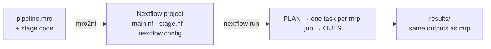

# mro2nf

**Run Martian pipelines as native Nextflow.**

mro2nf transpiles a [Martian](https://martian-lang.org) pipeline (`.mro`) into a
[Nextflow](https://www.nextflow.io) project. The project runs your existing
stage code, unchanged, and publishes the same outputs that Martian's own
runner, `mrp`, publishes.

## Why

Martian pipelines, such as 10x Genomics' Cell Ranger, run under `mrp`, which
supports a local machine and a few grid schedulers. Nextflow runs the same
work on many more targets and brings its own tooling. mro2nf joins the two:

- **Your stage code runs as is.** Each task runs the original stage through
  Martian's own adapter, with the same inputs (`_args`) and outputs (`_outs`)
  `mrp` would give it.
- **The outputs are the same as `mrp`'s.** Every test fixture that `mrp` can
  run is run under both `mrp` and Nextflow, and the published files are
  compared byte for byte. The known differences are listed, with the reason
  for each.
- **It runs wherever Nextflow runs.** One project runs locally, on Slurm,
  SGE, LSF or PBS, in Docker, on AWS Batch, and on AWS HealthOmics. You pick
  the target at launch with `-profile`.
- **It costs no more than `mrp`.** A run has one task per job `mrp` would run,
  plus one task at the start and one at the end. Each task stages only the
  data it reads.
- **It is plain Nextflow.** `-resume`, `-with-report`, `withName:` selectors
  and `nextflow log` work as usual.

## How it works

mro2nf compiles the pipeline with Martian's own compiler and emits one
Nextflow process per stage. At run time, a small shim, `mre`, sits between
Nextflow and the stage: it builds each stage's arguments, runs the stage
exactly as `mrp` runs it, and hands its outputs back to Nextflow. Nextflow
does the scheduling, staging, caching, retries and publishing.

[Architecture overview](docs/architecture/overview.md) explains the design.

## Documentation

| I want to… | Read |
|---|---|
| Install mro2nf and run a first pipeline | [Getting started](docs/getting-started.md) |
| Run, size and troubleshoot a pipeline | [User guide](docs/README.md#user-guide) |
| Check whether a Martian feature is supported | [Feature coverage](docs/reference/feature-coverage.md) |
| See every known difference from `mrp` | [Divergences](docs/reference/divergences.md) |
| Understand how the transpiler works | [Architecture](docs/README.md#architecture) |
| Build, test or release mro2nf | [Contributing](CONTRIBUTING.md) |

[All documentation](docs/README.md)

## License

MIT; see [`LICENSE`](LICENSE). The binaries and the runtime image also carry
third-party code, listed with its licenses in
[`THIRD_PARTY_NOTICES`](THIRD_PARTY_NOTICES). The vendored Martian adapters
keep Martian's license in [`vendor-martian/LICENSE`](vendor-martian/LICENSE).
