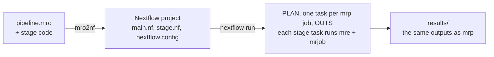

# mro2nf

mro2nf transpiles a [Martian](https://martian-lang.org) pipeline (`.mro`) into
a [Nextflow](https://www.nextflow.io) project. The project runs your stage
code unchanged and publishes the same outputs as Martian's runner, `mrp`.

## Why

Martian pipelines, such as 10x Genomics' Cell Ranger, run under `mrp`, which
supports a local machine and a few grid schedulers. Nextflow runs the same
work on many more targets, with caching, retries, reports and cloud executors.
mro2nf gives a Martian pipeline those targets without changing the pipeline.

It promises two things:

- **The stage ABI.** Each stage job gets the same `_args` and `_jobinfo`, and
  writes `_outs`, exactly as under `mrp`, through Martian's own adapter.
- **The same outputs.** A run publishes the `outs/` tree and
  `pipeline_outs.json` `mrp` publishes, on every run. The tests run every
  fixture under both runners and compare them; each known difference is
  listed with its reason.

Everything between stage jobs is plain Nextflow: channels, joins, `path`
staging, `-resume`, profiles. A run has one task per job `mrp` would run,
plus one at the start and one at the end, and each task stages only the data
it reads. One project runs locally, on Slurm, SGE, LSF or PBS, in Docker, on
AWS Batch, and on AWS HealthOmics.



## Quick start

From a clone, with mro2nf [installed](docs/usage.md#install) and Nextflow
26.04 or later:

```bash
mro2nf -o out testdata/split_test/pipeline.mro
cd out && echo '{"values": [5, 6, 7]}' > inputs.json
nextflow run main.nf -params-file inputs.json
cat results/pipeline_outs.json
```

## Documentation

| Page | Covers |
|---|---|
| [Usage](docs/usage.md) | install, transpile, run, profiles, parameters, resources, images, files, troubleshooting, upgrading, compatibility |
| [Feature coverage](docs/feature-coverage.md) | which Martian features work |
| [Divergences](docs/divergences.md) | every known difference from `mrp`, and why |
| [Design](docs/design.md) | how it works, with links to the code |
| [Contributing](CONTRIBUTING.md) | building, testing, CI and releases |
| [Security](SECURITY.md) | what stage code can do, and how to report a vulnerability |

Changes are listed in each [release's notes](https://github.com/eunmann/mro2nf/releases).

## License

MIT; see [`LICENSE`](LICENSE). The binaries and the runtime image carry
third-party code, listed in [`THIRD_PARTY_NOTICES`](THIRD_PARTY_NOTICES). The
vendored Martian adapters keep Martian's license in
[`vendor-martian/LICENSE`](vendor-martian/LICENSE).
