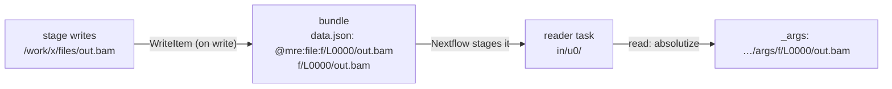
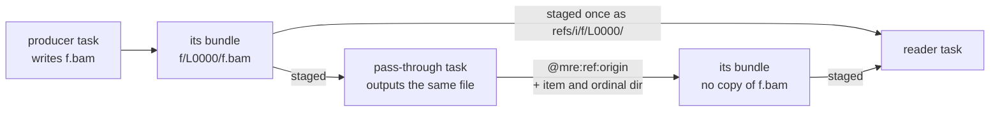

# Bundles and file flow

Under `mrp`, every job reads its upstream outputs from one shared pipestance
directory. Under Nextflow, a task sees only what is staged into it. This page explains
how typed values, and the files they name, move from the task that wrote them
to the tasks that read them, without copying a file more than once.

## Bundles

A **bundle** is `mre`'s container for a set of typed values, including the
files they reference, that one task hands another: a per-output field bundle,
a chunk's args, a chunk's outputs, a fork element. On disk it is a directory
([`internal/shim`](../../internal/shim)):

```
<bundle>/
  data.json            the typed JSON (scalars, arrays, maps, structs), with a
                       marker at each file leaf
  f/L0000/reads.fastq  each file leaf in its own ordinal dir, in the type walk's
  f/L0001/reads.fastq  order, so leaves never collide, under the basename mrp
                       passes the stage (#284)
  f/L0000/.mre-origin  the leaf's origin (#431)
  instance.json        the instance stamp (field bundles)
  task.json            where the posting task ran (field bundles)
  fork.json            the fork record (fork element dirs)
  .mre-skeleton.json   the skeleton: every path above and the records' contents,
                       no leaf's bytes (#610)
```

A small value never becomes a bundle: an output or element whose type holds
no file leaf, with at most `cg.MaxValueBytes` (4 KiB) of JSON, travels as a
value record
through the driver's channels instead ([Run time](runtime.md#reads)).

### Basenames

A leaf keeps the basename its path had where `WriteItem` found it: the file a
stage wrote (Martian's `<out>.<ext>` default, or any path the stage chose), a
split's chunk-def file, or the upstream leaf a binding forwarded unchanged.
That is the path `mrp` passes on, so a stage that reads a sample name or an
extension from `os.path.basename()` sees the same value under both runtimes.

A task stages its inputs as whole bundle directories under `in/u<i>` names,
and the files they name by reference that lie in none of those as ordinal
directories, `refs/<i>/f/L<nnnn>`, so a stage-chosen basename never appears in
Nextflow's stage-in script.

### Skeletons

`WriteItem` writes the skeleton last, so it holds the records written before
it, a field bundle's stamps among them. It lists each path as `CopyTree`
copies a leaf, with links followed and a dangling one left out, so a
directory leaf's skeleton holds every file and directory in it.
Post-processing moves a file inside a published directory out of it, and the
skeleton keeps where. OUTS stages skeletons in place of the bundles it reads
([Run time](runtime.md#outs)).

## Markers

In `data.json`, every file leaf is replaced with a **marker**,
`@mre:file:f/L<nnnn>/<basename>`, a path relative to the bundle. A leaf staged
from a **directory** (a `path` output, or a directory a stage wrote into a
`file`-typed output) uses `@mre:dir:` instead, so whether it is a directory,
checked when it is staged, travels to publishing rather than being inferred
from the declared type. Both prefixes resolve the same way on read.



The rules:

- **On write.** A stage produced an output that is a real file: the file is
  copied into the bundle's `f/` tree and the leaf is made relative, a marker.
  [`shim.WriteItem`](../../internal/shim/refs.go) walks the compiled types to
  find exactly which leaves are files, recursing into structs, arrays and
  typed maps ([`internal/types`](../../internal/types)).
- **Escaping.** Every other string that begins with the reserved `@mre:`
  prefix (a string input, a `.mro` literal, a stage's string output, a
  file-typed output naming no file) is stored as `@mre:str:<original>`. A
  marker in `data.json` is therefore always one `WriteItem` wrote at a file
  leaf the type walk found, never a user's string.
- **On read.** Markers are turned back into real paths inside the staged
  bundle, so the stage opens a real local file, and escaped strings get their
  original value back, so the stage sees exactly the string `mrp` would pass
  it. A marker is accepted only in the shape `WriteItem` writes
  (`f/L<nnnn>/<basename>`: exactly one name under the ordinal directory, not
  `.` or `..`, inside the bundle), and a reference only naming an absolute
  origin; any other `@mre:` string fails the read. `mre outs` reads the
  pipeline outs this way, so the published outs carry the original strings.

## Linked args

A task's args are read only by its own job, so `mre stage` links each of their
file leaves below `-args` ([`shim.LinkLeaves`](../../internal/shim/bundle.go))
instead of copying it, and writes no payload: a leaf of a staged bundle by its
ordinal directory, whose origin record comes with it, any other file by itself
beside its origin record, and `_args` names each at its link.

- A file every fork of a map call reads, such as a broadcast upstream output
  or entry file, exists once, its producer's, however wide the fork (#498).
- A split's chunks and join build their own args from the split's inputs,
  which Nextflow stages into them, so no task outputs args and none carries a
  copy of the files they name (#507).

## Origins

A file is one file to `mrp` wherever it is referenced, so a bundle copies it
once and gives every position that reaches it one marker, however many input
bundles it arrived through.

- **Identity.** A file's identity is its origin: the absolute path it was first
  staged from, where its task wrote it, recorded in `.mre-origin` beside the
  leaf. A leaf of a staged bundle, such as the input a pass-through stage
  returns, keeps the origin recorded beside it. A path inside a staged
  directory leaf takes that leaf's origin joined with the path below it, so a
  file inside a directory the run was given stays linked.
- **How `mrp` publishes it.** The record also says how `mrp` publishes the file
  (`linked:` before the path): a stage output that was a symlink, or a file from
  outside every task (a host file, or one the run was given), is linked into
  `outs/` at each output that reaches it, where a stage's own file is moved to
  the first and the others link to it (`post_process.go` `moveOutFile`,
  `copyOutSymlink`).
- A leaf named `.mre-origin` fails the write.

`mre outs` places each file of the pipeline outs in the pipestance it
reconstructs by its origin ([The `mre` shim](mre.md#mre-outs)).

## Files by reference

A post, a split's chunk defs and a chunk's outputs often name a file the task
did not write: a whole leaf of a bundle it staged, such as a join's outputs
naming its chunks' files, a stage returning its input, or a split forwarding
its input into each chunk's def. Copying that file into the new bundle would
upload it again. Instead the bundle names it **by reference**.



1. **The writing task** records the marker `@mre:ref:<origin record>` in place
   of a copy, and lists, per bundle, the item the file lies in by the path the
   task staged it at (`in/u<i>`, `refs/<i>`, `chunk/<name>`, `chunks/<name>`,
   `chunkouts/<name>`) and the file's ordinal directory there (`-field-refs`,
   `-fork-refs`, `-out-refs`). It detects a reference by the path it staged the
   item at, not by a link, so this holds on an object store, where Nextflow
   stages a copy.
2. **The driver** joins each posting task's outputs, by instance key, to the
   paths it staged its items from (`POSTED`, with `SOURCES`, `JOIN_SOURCES`),
   and resolves each record to the ordinal directory in the producer's work
   directory. A task's records come on one line, space-separated, so an `eval`
   output of them is collected in time linear in them. A split's come in a
   file, `chunk_refs`, and a chunk's as an `eval` output, which `CHUNKS` and
   `JOIN` resolve (`chunked`, `joinRefs`), so each chunk stages the files its
   def names, and the join those every chunk's def and outputs name.
3. **A reader** stages those ordinal directories once each as
   `refs/<i>/f/<ordinal>/` (`refsOf`), and OUTS the skeleton of each bundle
   holding them once as `refs/<i>` (`refBundles`). Nextflow stages the file
   from where its producer wrote it: a link on a shared filesystem, a download
   on an object store. The writing task uploads none of it again.
4. **Resolution.** A reader resolves a reference among the ordinal directories
   it staged, in its items or by reference, each beside its origin record
   ([`shim.Staged.Leaves`](../../internal/shim/refs.go): the first of an origin
   in the order the task names its staged directories), and fails on one it did
   not stage. It then links the file into its args, and `mre outs` places it,
   as it would a copy of the same origin, so `_args`, the published tree and the
   outs JSON are the same bytes. A chunk and a join read a chunk def's or a
   chunk's outputs' reference where they staged it, in an item
   (`in/u<i>/f/<ordinal>/<basename>`) or by reference
   (`refs/<i>/f/<ordinal>/<basename>`), where a copy lay below `chunk/<name>/`
   or `chunks/<name>/`: the basename the stage sees, and the file, are the
   same.

An ordinal directory that lies in an item the reader stages whole, such as the
input a split forwarded into its chunk defs, which each chunk and the join
stage as `in/u<i>`, is not staged again (`unstaged`). So the file is
downloaded once per reader.

What this bought:

- On Cell Ranger on AWS Batch, the `MAKE_SHARD` join spent 31.8 s re-uploading
  its chunks' shards before this (#562).
- A split forwarding its input into M chunk defs uploaded M copies of it.
- `split_forward_file`, with a 10 MB file, copy-staged: 21.0 MB staged per
  chunk and for the join before, 10.5 MB after.

A reader's `-resume` key holds the ordinal directories' paths, which a cached
producer keeps.

Nextflow's own `includeInputs` cannot do this: an output it matches is named
in the task's own work directory and is unstaged from it like any other output
(`TaskFileCollector`, `AwsBatchFileCopyStrategy.getUnstageOutputFilesScript`),
and a posted bundle holds its files below a directory of its own.

A file inside a staged directory leaf is still copied, as staging the whole
directory to every reader would cost more than the one file. An entry file is
still copied too.

## Symlinks and confinement

Nextflow stages inputs as symlinks. When `mre` copies a file leaf into a
bundle, it follows the symlink to the real target first; otherwise the bundle
would carry a link that dangles once staged into another task
([`shim.CopyTree`](../../internal/shim/bundle.go)).

For a stage's own outputs, following links is confined
([`shim.Confinement`](../../internal/shim/confine.go)). An output, and every
symlink it passes through, is classified as one of:

| Path | Treated as |
|---|---|
| the stage's own file inside the task work directory | hard-linked into the bundle |
| a path in the work directory outside the stage's phase directory: a staged input | followed wherever it points, hard-linked |
| a path outside the task, inside what a staged input links to: an input's real path, which a stage that resolves its args' paths returns | hard-linked, as the input it resolves from |
| a path under one of the run's read-only roots: the S3 mount, or an entry input every task reads in place ([Inputs](inputs.md)) | copied as a staged input; as an output, the path under the root stays a path, so a stage returning its input's path copies nothing |
| a path in the pipeline's code, its include path or a stage's code directory, which every task finds at the path it was transpiled from, on the host or in the image | as an output, the path stays a path, as `mrp` keeps it; a link the stage made into it is any other host path |
| any other host path outside the task | see below |

For any other host path:

- under `--mro2nf_confine true` (`mre stage -confine`), the path cannot be
  valid in an isolated container downstream, and copying it would upload host
  data, so the task fails, naming the output. The container profiles always
  confine;
- otherwise, since `mrp` publishes a symlink and pipelines legitimately return
  paths into host reference directories, the target is staged as a byte copy,
  never a hard link, so no later write through the bundle can alias the host
  file.

Next: [Inputs](inputs.md).
