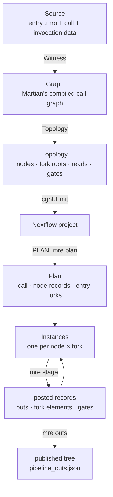

# Concepts

The data structures mro2nf works with, and the algorithms that move between
them, each linked to its code. Martian's own structures come from the pinned
module; links to it point at the pinned commit,
[`50ad6c0`](https://github.com/martian-lang/martian/tree/50ad6c054d30).

## Martian's structures

| Term | What it is | Code |
|---|---|---|
| Call graph | Martian's compiled form of a pipeline invocation: every stage call as a node with its resolved bindings. `mrp` compiles it before it makes a pipestance, and so does mro2nf. | [`syntax.MakePipelineCallGraph`](https://github.com/martian-lang/martian/blob/50ad6c054d30/martian/syntax/resolve.go) |
| Node, fqid | One stage call in the call graph, named by its fully qualified id, such as `SUM_SQUARE_PIPELINE.SUM_SQUARES`. | `syntax.CallGraphStage` |
| Fork root | A `map call` whose forks a node runs under. A node's fork roots are the map calls it is nested in. | `syntax.ForkRootList` |
| Fork | One element of a fork root's collection: an array index or a map key. A node runs once per combination of its roots' forks. | [`internal/cg/fork.go`](../../internal/cg/fork.go) `Fork` |
| Split, merge | Martian's compiled expressions for a `split` over a collection (`SplitExp`) and for gathering a map call's forks back into a collection (`MergeExp`). | `syntax.SplitExp`, `syntax.MergeExp` |
| Disable binding | A `using (disabled = …)` binding, compiled to a `DisabledExp` that gates a node per fork. | [`core/stage.go`](https://github.com/martian-lang/martian/blob/50ad6c054d30/martian/core/stage.go) `Fork.disabled` |
| Split stage | A stage with a `split` block: one split job, one main job per chunk, one join job. | [Run time](runtime.md#split-stages) |

## mro2nf's structures

| Term | What it is | Code |
|---|---|---|
| `Source` | The entry file's declarations, its call, and the call's invocation data, compiled as `mrp` compiles them. | [`internal/cg/source.go`](../../internal/cg/source.go) |
| `Graph` | A compiled call graph with its type table: the one place a stage instance's `_args` are built. | [`internal/cg/graph.go`](../../internal/cg/graph.go) |
| Witness | A made-up invocation whose call graph holds every node and fork root any real invocation of the call can have. The project is built from it. | [`Source.Witness`](../../internal/cg/source.go), [Transpile time](transpile.md#the-witness) |
| `Topology` | The witness call graph reduced to what tasks exchange: per node its fork roots, the outputs it reads, its gates and preflights; per root, the stage that fixes its forks. | [`internal/cg/topology.go`](../../internal/cg/topology.go) |
| `Read`, `ReadPattern` | One node's read of another's outputs, and which of the other's instances each reader instance reads: those agreeing on shared roots, at the reader's own index of an aligned root, optionally only at some of the reader's forks. | [`internal/cg/align.go`](../../internal/cg/align.go) |
| `Plan` | PLAN's output: the run's call, one record per node (spec digest, static gates, resources), the entry files, and the forks of every entry-fed root. | [`internal/cg/plan.go`](../../internal/cg/plan.go) |
| Spec digest | A SHA-256 of a node's resolved spec. A task fails when its node compiles to another digest than PLAN planned, so stale code fails loudly. | [`Graph.specDigest`](../../internal/cg/plan.go), `cg.ErrSpecDrift` |
| `Instance`, instance key | One run of a node at one fork. Its key is its ordinal of each of its roots' forks, which the driver joins on. | [`internal/cg/record.go`](../../internal/cg/record.go) |
| Fork id | `mrp`'s name for a fork, such as `fork0`, which names jobs in `_jobinfo`. | [`internal/cg/forkid.go`](../../internal/cg/forkid.go) |
| Fork element | One fork of a stage-fed root, posted by the stage whose outputs fix it: the element of the split collection and its fork record. | [`internal/cg/post.go`](../../internal/cg/post.go) |
| Partner element, token | The element of a zipped output at one fork's index, for a map call that splits several collections. A map key's token is the hex SHA-256 of the key, so no key needs escaping. | [`internal/cg/partner.go`](../../internal/cg/partner.go) |
| Gate | The set of instances a stage's outputs disable, posted by that stage and looked up on the driver. | [Run time](runtime.md#gates) |
| Value record | A small output or element (no file leaf, at most `cg.MaxValueBytes`, 4 KiB, of JSON) carried through the driver's channels as base64, instead of staged as a file. | [`internal/cg/values.go`](../../internal/cg/values.go) |
| Bundle | A directory holding a typed JSON payload and the files its leaves name: how outputs, chunk definitions and fork elements move between tasks. | [Bundles and file flow](bundles.md) |
| Marker | The `@mre:` string that stands for a file leaf inside a bundle's JSON. | [`internal/shim`](../../internal/shim) |
| Origin | The absolute path a file was first staged from, which identifies the file however many bundles carry it. | [Bundles and file flow](bundles.md#origins) |
| Skeleton | A bundle's paths and records with no file bytes, which OUTS stages to lay out the published tree. | [`internal/shim/skeleton.go`](../../internal/shim/skeleton.go) |

## Algorithms

| Algorithm | What it does | Code |
|---|---|---|
| Compile | Parse the `.mro` and build the call graph with Martian's compiler, exactly as `mrp` does, so a pipeline `mrp` refuses is refused with `mrp`'s message. | [`internal/cg/graph.go`](../../internal/cg/graph.go) |
| Witness construction | Give every entry input a value of its type with two elements in every collection, nested collections of different lengths, `false` for every bool and no null, so no node is pruned or disabled. | [`Source.Witness`](../../internal/cg/source.go) |
| Fork-root feeders | Find the stage whose outputs fix a root's fork count by walking Martian's compiled split source case for case, as `mrp`'s fork expansion does. | [`internal/cg/topology.go`](../../internal/cg/topology.go); upstream [`Fork.expandForkPartFromSource`](https://github.com/martian-lang/martian/blob/50ad6c054d30/martian/core/fork.go) |
| Read collection | Walk each node's bindings to find exactly which outputs of which nodes it reads, including what counting a merge's forks reads. | [`internal/cg/topology.go`](../../internal/cg/topology.go) `collectReads`, [`internal/cg/graph.go`](../../internal/cg/graph.go) `countReads` |
| Read alignment | Match a split over another map call's outputs to the reader's own fork, so fork *i* of the reader stages only fork *i* of the upstream, never all N. | [`internal/cg/align.go`](../../internal/cg/align.go) |
| Merge counting | Decide which forks a merge gathers, case for case with `mrp`'s `getParts`. | [`Graph.mergeCounted`](../../internal/cg/merge.go); upstream [`TopNode.getParts`](https://github.com/martian-lang/martian/blob/50ad6c054d30/martian/core/resolve.go) |
| Per-instance resolution | Resolve one instance's `_args` from what its task staged, with Martian core's resolution ported to read staged records. | [`internal/cg/resolve.go`](../../internal/cg/resolve.go), [`internal/mrcore`](../../internal/mrcore) |
| Type-directed file-leaf walk | Walk a value by its compiled Martian type to find every file leaf, in arrays, typed maps and nested structs, so no string is guessed to be a path. | [`internal/types`](../../internal/types) |
| Keyed joins | Match each instance with the outputs it reads by instance key, with Nextflow's `combine`, `join` and a seeded `groupTuple`. | [`internal/cgnf`](../../internal/cgnf), `stage.nf` |
| Workflow packing | Cut the stage wirings, in dependency order, into workflows small enough for the JVM's 64 KiB method limit (`maxWeight`) and 255-argument call limit (`maxTakes`). | [`internal/cgnf/scope.go`](../../internal/cgnf/scope.go) |
| Deterministic order | Sort every staged list by instance key, output or chunk name, never by completion order, so `-resume` keys and published outputs do not vary. | [Run time](runtime.md#order) |
| Post-processing | Lay out the published `outs/` tree and `pipeline_outs.json` with `mrp`'s own `PostProcess`, over skeletons. | [`internal/cg/outs.go`](../../internal/cg/outs.go) |

Next: [Transpile time](transpile.md).
