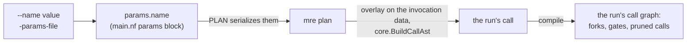

# Inputs

The top-level `call EP(reads = …, scale = …)` gives the pipeline's default
inputs, which the project's copy of the entry `.mro` (`_assets/mro/`) carries.
A run overrides them at launch, without re-transpiling.
[Parameters](../user-guide/parameters.md) is the user-facing summary; this page
explains how it works.

## Launch values

- **Parameters.** Every entry input is a nullable Nextflow parameter,
  `params.<name>`; null keeps the transpiled value. PLAN hands them to `mre
  plan` as one JSON object, which overlays them on the invocation data and
  recompiles the call. So a launch value can change the run's forks, gates and
  pruned calls as an invocation literal would under `mrp`.
- **Declared parameters.** `main.nf`'s `params` block declares every launch
  parameter, the entry inputs and the project's own (`paramsBlock`, from the
  same model as `conf/base.config`;
  [`internal/cgnf/params.go`](../../internal/cgnf/params.go)), so Nextflow
  fails a launch that sets an undeclared one, such as a misspelt input, where it
  would otherwise ignore it. Config-set parameters stay declared, as
  `conf/base.config` and the profiles set only those.
- **Types.** The block types a `string` input as `String?` and leaves every
  other input `Object?` (`entryType`). On 26.04, an `Integer` refuses a params
  file's whole-number float (`{"n": 2.0}`), which Martian assigns to an `int`
  (`syntax/builtin_types.go`); a `Float` narrows a command-line value to 32
  bits; an unset `Boolean`, even one declared `= null`, becomes `false`,
  overriding the `.mro`'s value; a `Path` checks an `s3://` value exists on the
  head node and changes its type; and a `List` or `Map` checks only its shape.
  A split input, whose value is `{"split": v}`, is untyped too. The project's
  own parameters are typed by kind (`String`, `Boolean`, `Map`), with their
  `conf/base.config` value as the default.
- **Command-line strings.** A command-line `--<name> <value>` of an entry input
  other than a `string` reaches `mre plan` as a string, so a scalar `int`,
  `float` or `bool` input is parsed strictly into its declared type: a base-10
  int64, a JSON number, or exactly `true`/`false`. A value that does not parse,
  or a string for an array, map or struct input, fails the run; set those with
  `-params-file`.
- **Split inputs.** An input the top-level `map call` binds with `split` takes
  Martian's invocation form of a split, `{"split": v}` with `v` an array or a
  map (`core/runtime.go` `convertToExp`), as `-params-file` takes Martian's
  invocation data. The rebuilt call splits `v`, so the fork count and keys
  follow the launch value. `mre plan` refuses any other value naming the input
  (`errSplitShape`), and the compile types `v`'s elements as `mrp`'s does.
- **Numbers.** Every number in a supplied value, typed or parsed and at any
  depth, keeps the text `mre plan` receives until the rebuilt call parses it
  (`core.BuildCallAst`). So it reaches the stage as `mrp` encodes the same
  literal: `--f 2.0` and a `-params-file` `{"f": 2.0}` both reach it as `2`,
  `1e6` as `1e+06`, a YAML params file's or a command-line `-0.0` as `-0`, and a
  whole number given to a `float` input, Martian's int literal, exact
  (`9007199254740993`).
- **Range checks.** `mre plan` parses each supplied value as `core.BuildCallAst`
  parses an invocation argument (`syntax.Parser.ParseValExp`) before it
  rebuilds the call ([`cg.CheckValue`](../../internal/cg/literal.go)), and
  refuses one holding an int outside int64 or a float beyond float64, naming
  the input and the literal. Martian's parser panics on such a literal
  (`syntax/parsenum.go`), as `mrp` does on it in an invocation; the check
  recovers that panic, as the transpile does for the `.mro`'s own literals
  (`cg.ReadSource`).
- **JSON params files** are the exception to both: Nextflow's `JsonSlurper`
  wraps an int beyond int64 into int64 and reads `-0.0` as `0.0` before `mre
  plan` sees the value, so the run takes the wrapped int and the stage gets `0`
  (the divergence `params-json-int-wrap`).
- **The v2 parser.** The string guarantee rests on the strict (v2) syntax
  parser, Nextflow's default from 26.04, the engine floor, and the only parser
  the project supports. The v1 parser (`NXF_SYNTAX_PARSER=v1`) converts
  command-line values before the script sees them: `--b True` becomes `true`,
  and `--s 007` becomes the integer `7`, which no later step can recover.
- **Reserved names.** An entry input named `job_resources` or `mro2nf_*`
  collides with a parameter the project defines itself and fails the
  transpile. So does one named with a word the params block cannot declare
  (`nextflowKeyword`,
  [`internal/cgnf/keywords.go`](../../internal/cgnf/keywords.go)): Nextflow's
  `paramDeclaration` takes an `identifier`, which excludes the words its lexer
  reads as keywords, quoted or not, and its parser refuses the Groovy keywords
  it reads as names (the divergence `keyword-input`).
- **Validation and the schema.** `mre plan` validates every entry value against
  its Martian type; the params block checks only that no undeclared parameter
  is set and that a `string` input's value is one. `nextflow_schema.json`
  ([`internal/cgnf/schema.go`](../../internal/cgnf/schema.go)) describes every
  parameter for launch forms and documentation: each entry input by the JSON
  Schema of its Martian type (`types.Table.Schema`) with the call's value as
  its default, a split input by Martian's split form of that type
  (`types.Split`) with the call's split value wrapped as `{"split": v}`, and
  the project's own parameters from the same model as `conf/base.config` and
  the HealthOmics `parameter-template.json`. No nf-schema plugin validates
  against it: a plugin is downloaded at launch, which an offline grid or
  container host cannot do, and HealthOmics installs only the versions it pins.

## File-typed inputs

Every file value of the run's entry inputs is either read in place or staged:

| Value | Profile | Handling |
|---|---|---|
| absolute path | `standard`, grid | read in place by every task ([below](#head-node-paths-read-in-place)) |
| absolute path | `docker` | staged |
| absolute path under the S3 root | `awsbatch` | read in place through the mount ([below](#mounted-s3-values)) |
| any other absolute path | `awsbatch`, `healthomics` | refused |
| `s3://` URI | `awsbatch`, bucket mounted under the S3 root | read in place through the mount |
| `s3://` URI | elsewhere | staged |
| `file:` URI | where head-node inputs are allowed: `standard`, grid, `docker` | staged |
| other URI (`http(s)://`, `ftp://`) | with `--mro2nf_allow_remote_inputs true` | staged |

A staged value is staged by Nextflow into the tasks that read it, and only
those. PLAN lists the staged values (`leaves`) and, per node and fork of its
entry-fed roots, the ones Martian's specialization of its bindings to that fork
reads (`files`), so a map call over entry files stages each fork's own element.
The pipeline outs' own reads, keyed by the pipeline's fqid, are staged into
OUTS, whose post-processing publishes such a file only where it finds it, as
`mrp`'s does, and which copies each one it publishes into its `external/`
directory ([Run time](runtime.md#outs)).

- The driver hands each value to `file(x, glob: false)`, so the head node never
  globs a name, and a task stages its list as `entry/<i>/<name>`. `mre stage
  -leaves` and `mre outs -leaves` map each value to the path it reads it at.
- The stage gets a staged value as a leaf linked below its args directory,
  `<task>/args/f/L<nnnn>/<name>`: the same file name and content, at another
  path than the value `mrp` passes.
- A value with no file (`[]`, `{}`, a null field) stages nothing.
- A relative path names nothing from the stage's job directory under either
  runtime and reaches the stage as given.
- A file default is read or staged from where it is at run time; it is never
  copied into the project.

### Head-node paths read in place

The `standard` and grid profiles run their tasks on the host's filesystem,
where every task sees the head node's paths. So `params.mro2nf_host_in_place`
is true there, and PLAN (`mre plan -host-in-place`,
[`cg.ReadInPlace`](../../internal/cg/entry.go)) marks every absolute value read
in place: a task reads the value where it is, and the stage gets the value
itself, the path `mrp` passes.

- PLAN leaves the value out of `leaves` and `files`, while it keeps its index
  among the values, which a task recomputes from the call.
- **Read-only roots.** Every task, told the same by `mre stage -host-in-place`,
  computes the run's read-only roots (`shim.Roots`,
  [`Graph.Roots`](../../internal/cg/entry.go)) from the call it compiles: each
  value read in place, and the S3 mount below. Every bundle writer keeps a leaf
  under a root as the path it is, with no link, copy or origin. So a stage that
  returns its input's path, as Cell Ranger's `SETUP_REFERENCE_INFO` returns
  `reference_path`, posts the path, and no byte of the input is copied into
  `work/`.
- A path in the task's own work directory is under no root, so a stage's own
  outputs stay its own even below an input directory.
- PLAN, handed the run's work directory (`-run-workdir`), refuses a value that
  is or holds it, which every task would otherwise read as an input.
- A task's `-resume` key holds the value's path, as `mrp`'s restart keys a
  pipestance on its invocation, not the file's content. Nextflow keys a staged
  file on its path, size and modification time, and a staged directory on the
  directory's own size and time, which a change to a file inside it leaves as
  they were. So for the directory inputs Martian pipelines take, the path is
  what a staged input was keyed on too.

The container profiles turn the parameter off (`conf/container.config`), so a
head-node value there is staged as a URI is: a container sees only what its
task stages and mounts. Reading it in place on `docker` would bind it into
every container, since a typed output can carry an input's path to any later
task (`SETUP_REFERENCE_INFO`'s `reference_path`), so a task's own inputs do not
bound the paths it opens. A run-wide bind list would cost every task one mount
option per value, quadratic in a map call's width over the run. `awsbatch` and
`healthomics` refuse a head-node value outright.

### Names Nextflow cannot stage

Nextflow's stage-in script, on 26.04, writes each staged file as `ln -s
<source> <name>`, leaving `*`, `?`, `[`, `]`, `{`, `}`, `$` and control
characters such as a tab for bash to expand: `s[1].txt` beside `s1.txt` stages
`s1.txt` silently. So PLAN refuses a staged value holding any of them, naming
the input and the character, before anything is staged. A value read in place
is never staged, so it may hold any of them, as under `mrp`.

### Which file values a run may read

`file()` on the head node fetches any URL Nextflow has a provider for and reads
any path the head node sees, and a run parameter comes from whoever launches
the run. So PLAN checks every value it lists:

- an `s3://` URI is allowed on every profile;
- a head-node path, read in place or staged, and a `file:` URI, staged, only
  where `params.mro2nf_host_inputs` holds (the local, grid and docker
  profiles);
- any other scheme (`http(s)://`, `ftp://`) only with
  `--mro2nf_allow_remote_inputs true`.

The errors name the input, not the value, which may carry a credential. The
HealthOmics parameter template declares neither option, so a HealthOmics run
cannot set them.

### Mounted `s3://` values

A stage that records an input's path in an output another task opens, as Cell
Ranger does with its FASTQ directory, needs the path `mrp` gives it: one path in
every task. A staged copy is at a path no other isolated task has.

Under `params.mro2nf_s3_mount`, a root at which every task's host may mount
input buckets read-only (the `awsbatch` profile's `/mnt/s3`, which Mountpoint
for S3 serves on the example stack's instances), PLAN (`mre plan -s3-mount`),
which runs on the same compute environment as every task:

1. rewrites each `s3://<bucket>/<key>` file value of the invocation whose
   bucket is a directory `<root>/<bucket>` to `<root>/<bucket>/<key>`, keeping a
   trailing `/`, before it compiles the call, so every task compiles a call
   naming the mounted path;
2. leaves a value of any other bucket as its URI, staged as on every other
   profile, which needs the tasks' role to read its bucket;
3. checks that the mount shows each mounted value's bucket and key, and leaves
   it out of `leaves` and `files`, while it keeps its index among the values.

Any directory there counts, not only a mount point: the e2e suite serves the
root as one bind-mounted tree, and the example stack's root holds nothing but
its mounts. A value under the root, written or given directly once cleaned, is
mounted too.

The root, which `mre stage -s3-mount` names, is one of the run's read-only
roots: every bundle writer keeps a leaf under it as its path, and a strict
confinement admits a stage's own link into it
([Bundles](bundles.md#symlinks-and-confinement)). OUTS publishes such a value
as a linked file, as it does a host path. A key of a mounted bucket with an
empty, `.` or `..` component, which Mountpoint cannot show, is refused. A
task's `-resume` key holds the value's path, not its content.

So the mount spares downloads and makes a recorded path hold in every task, and
no run requires it.

Next: [Targets](targets.md).
