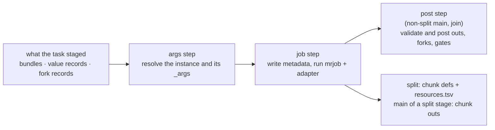

# The `mre` shim

`mre` ([`cmd/mre`](../../cmd/mre)) is the program every task of a run calls.
It has three subcommands, one per kind of task:

| Subcommand | Task | Does |
|---|---|---|
| `mre plan` | PLAN | compiles the run's real invocation and writes the records the driver wires the run from |
| `mre stage` | every stage task | resolves one instance's `_args`, runs its job as `mrp` runs it, and posts its outputs |
| `mre outs` | OUTS | resolves the pipeline outs and lays out the published tree with `mrp`'s post-processing |

## Common inputs

Each subcommand that works on the call graph takes:

- the entry `.mro` (`-entry`, `-mropath`);
- the run's call (`-call`), a file holding base64 of the call PLAN rebuilt,
  which each task writes or stages, since a wide run's call would pass the
  kernel's 128 KiB limit on one argument; without it, the entry's own call;
- the items its task staged (`-in`, an item or a directory of items), and only
  those.

It compiles the call over the entry's declarations as `mrp` compiles an
invocation (`ParseSourceBytes`, then `MakePipelineCallGraph`), as the entry
file. It finds a bundle's file leaves by the types the invocation compiled to:
Martian's type table, which holds every filetype and struct, and the struct of
each callable's outputs.

## `mre plan`

`mre plan` starts a run ([Run time](runtime.md#plan)). It:

1. rebuilds the run's invocation from the transpiled entry and the run's entry
   values, and compiles it;
2. checks it against the witness;
3. vets the entry file values the run reads ([Inputs](inputs.md));
4. writes the call every task compiles, one record per witness node, the entry
   files of each node's instances and of the pipeline outs, and the forks of
   every entry-fed fork root, a record each.

With `-overrides`, it reads the run's `mrp --overrides` file with Martian's
`ReadOverrides`, which fails on a key it does not know. Each node's record then
carries the cpus and memory of its first job (its split, or its one main) and
an overrides file of the node's own, `{"<fqid>": {...}}`: of each phase the
node runs, each resource Martian's `ApplyResourceOverrides` sets for it, found
at the key nearest the node.

## `mre stage`

`mre stage -phase split|main|join -node <fqid>` is the one `mre` call of a
stage task. It compiles the call graph once and runs the steps the phase has,
each handing the next the instance, its args and its outputs in memory:

- Every phase first resolves the instance and its args from what its task
  staged, each file leaf linked below `-args`, as no other task stages it.
- It then runs its job.
- A join, or a non-split stage's main, then posts the outputs its job wrote.
- A split's chunk mains and join stage the split's inputs and resolve the same
  args the split did.

An instance its args resolve disabled, where its gates held it enabled, fails
the task with exit 1 before any job runs, and writes nothing. A failed job
exits as [the job step](#the-job-step) says, and no post follows it; a failed
args or post step exits 1. Only the files the job and the task's consumers
read are written: `_args` names each file leaf at its link below `-args`.

### The args step

The args step (`-node <fqid> -digest <d>`) resolves one stage instance and its
args, once the node compiles to the spec digest PLAN planned.

- The instance's fork comes from the fork elements it staged or got as value
  records (`-values`), or the fork records it got as values (`-fork`, base64 of
  a `fork.json`).
- Its values come from its parents' stamped outputs bundles and value records.
- The instance records the fork and each part's fork count, from which
  `mrp`'s fork id follows.

A map call that zips several splits forks over its master source: a split of
known length if one has it, else its first split in source order. The other
splits resolve at the same index and, as in `mrp`, read null past the end of a
shorter source or from a null one, and drop a longer one's extra elements. The
missing element is logged, as at `mrp`'s default enforcement level; `mrp
--strict` is not supported.

Resolution runs Martian core's own per-instance resolution, ported to read
staged records ([`internal/mrcore`](../../internal/mrcore)), and Martian's
exported functions for specialization, projection, narrowing and validation
(`ResolvedBinding.BindingPath`, `LazyArgumentMap.Path`, each type's
`FilterJson`, and the validators).

### The job step

The job step runs the task's phase of the instance as `mrp` runs its job
([`internal/job`](../../internal/job)).

- **How it runs.** `py` and `comp` stages run under `mrjob`, built from the
  pinned module (`make build`), with `mrp`'s argv (`core/node.go` `runJob`):
  `mrjob <adapters>/python/martian_shell.py <code> <phase> <meta> <meta>/files
  <journal>`. `exec` stages run directly. `-mrjob` defaults to the `mrjob`
  beside `mre`'s binary, and `-adapters` to the Martian adapters `mre` embeds
  (`vendor-martian/python`), which a `py` stage's job writes below its work
  directory as `_mre_adapters`.
- **What it writes first.** Before the job, `mre` writes what `mrp` writes,
  through Martian's own types and metadata writer: `_args` (the chunk or join
  def's resolved resources over the bindings), `_jobinfo`, the pre-populated
  `_outs`, `_chunk_defs` and `_chunk_outs` for a join, and the files, tmp and
  journal directories. `_jobinfo` carries `mrp`'s name,
  `ID.<psid>.<fqid>.<fork id>[.chnkN]`, the top-level call's invocation, the
  Martian runtime's and the pipelines' versions, and `monitor_flag` under
  `-monitor`, which `mrjob` enforces.
- **The outcome.** `mrjob` exits 0 however the stage ends, so `mre` reads the
  outcome from the metadata:

  | Metadata | `mre` exits |
  |---|---|
  | `_assert` | 42, never retried |
  | `_errors` or a non-zero exit, a line matching a `retry_on` pattern of `mrp`'s `jobmanagers/retry.json` | 75, retried |
  | `_errors` or a non-zero exit, otherwise | 1 |

- **A split** writes `-o` as one directory per chunk, named as `mrp` names it
  (`chnkN`), with its args bundle and `chunk.json`, plus `join.json` and
  `resources.tsv`: per chunk, then the join, its name, cpus, memory and
  special, as its job's `_jobinfo` records them (`Runtime.Resources`).
- **A split stage's main** writes its chunk's outputs bundle (`-o`), which its
  join stages. A non-split stage's main and a join hand their job's outputs to
  the post step.
- **Confinement.** The files a job names are confined to the work directory
  ([Bundles](bundles.md#symlinks-and-confinement)), strictly under `-confine`,
  but a whole leaf of a bundle the task staged is named by reference
  ([Files by reference](bundles.md#files-by-reference)).

Beside the job's metadata, `mre` writes `_mre_stage`, the name of the stage
the job ran. The adapter never reads it; the `mrp` ABI differential
(`TestMrpDiff`) uses it to group stage invocations without depending on the
Nextflow task graph, and the failure-parity test (`TestMrpDiffFailureParity`)
to name the stage a failed task ran.

### The post step

The post step runs after the stage's last job, on the outputs the job wrote.

1. **Validate.** It checks them with Martian's
   `LazyArgumentMap.ValidateOutputs`, as `mrp`'s `Fork.verifyOutput` does.
2. **Fork elements.** It writes one element per fork of every root this stage
   feeds: `forks/<root fqid>/<ordinal>/`. The ordinal is zero-padded, in `mrp`'s
   fork order (array index, or map keys in byte order). Each holds that fork's
   element of the source collection and `fork.json`, which records the real
   fork (keys as JSON strings) and its position. A small element (no file
   leaf, at most `cg.MaxValueBytes` of JSON) is a value record in the
   `-fork-values` file instead. A map key's fork also carries the key's token,
   the hex SHA-256 of the key, after an `@`; an array fork's token is its
   index.
3. **Partner elements.** For each output that a map call splits other than as
   its root's source (a map call zipping several outputs, or a disable binding
   splitting one), it writes one partner element per element,
   `forks/<root>@<node>.<output>/<token>/`, and an absent record, `none`, which
   reads null where the output is null, and a missing element, logged, at any
   index it lacks, as `mrp` reads it. A zip of maps at run time need not share
   keys (`zip_runtime_map`). An instance therefore gets only its own elements,
   and no key ever needs escaping.
4. **Outputs.** It writes the outputs one by one, so a consumer gets only the
   outputs it reads: a small one as a record in the `-field-values` file, any
   other as one bundle stamped with the instance (`instance.json`),
   `<-fields>/<output>/`.
5. **Gates.** With `-gates`, it writes the instances the outputs disable: of
   each node with a disable binding that reads this stage alone, every fork it
   resolves true at, as `mrp`'s `Fork.disabled` reads it (a null reads false),
   named `<node>@<roots>@<ordinals>`.
6. **Task record.** Each bundle it posts also records, in `task.json`, the
   directory it posted from, where its stage ran, and the bundle's path there.

A root whose fork set varies with an outer map call gets its forks under each
fork of that call: the posting task prefixes the name with the ordinal of each
outer call its own fork does not fix, joined by dots. A root of known length is
keyed by its own forks alone. `mre plan` writes the forks the call graph
already fixes (literal and entry-sourced sources) the same way, as fork records
without values.

## `mre outs`

`mre outs` resolves the pipeline outs, checks them with
`MarshalerMap.ValidatePipelineOutputs`, and publishes them with `mrp`'s own
post-processing (`Pipestance.PostProcess`), so the published tree and the outs
JSON follow `mrp`'s rules by construction.

1. **Reconstruct a pipestance** (`-work`): the top fork's `_outs` holds the
   resolved outs, each file leaf placed by its origin
   ([Origins](bundles.md#origins)). A top-level `map call`'s outs are an array
   or a map of its pipeline's outs, one per fork, whose files `PostProcess`
   publishes under `outs/<fork key>/`. The pipestance is attached read-only from
   the invocation, with a runtime that needs no job manager, so no Martian
   install is read.
2. **Post-process.** A stage's own file is one path in the pipestance however
   many outputs reach it, which `PostProcess` moves into `outs/` at the first
   and links the others to. A linked file is a path outside the pipestance per
   output that reaches it, which `PostProcess` links into `outs/` at that
   output.
3. **Check.** `PostProcess` reports no error, so `mre outs` then checks every
   name it wrote: a path in `outs/` must exist, and no path of the
   reconstruction may reach the outs JSON.
4. **Manifest** (`-manifest`): each entry a file or a placed directory, whole,
   and a link as what it reaches, by its path in the tree and where the task
   that wrote it keeps it, or, for a file no stage task wrote, its copy in
   `external/`. `PostProcess`'s rename keeps a placed path's identity (device
   and inode), which maps it to the file it was placed from. It places each
   file as its shape (`shim.CopyShape`), never its bytes.
5. **Outs JSON** (`-json`): naming a published file by its path in the tree,
   a linked one by its own link's path, and a file left unpublished (below an
   array of two or more dimensions) by where its producer's work directory
   keeps the copy it staged (`-locations`). A path the stage declared and never
   wrote is named below the work directory of the task that posted it
   (`task.json`).

## How it is checked against `mrp`

`TestMrpCallGraph` (e2e) replays every mrp-diff fixture's real `mrp`
pipestance through these subcommands, running every task through `mre stage`
as a run's tasks do. It requires:

- the same `_args` as `mrp`'s, after both are re-encoded and file leaves are
  reduced to name and content digest;
- an instance `mre stage` refuses as disabled exactly where `mrp` disabled the
  fork;
- every job `mrp` ran to run, and no other, with the same `_args`, `_outs` and
  `_jobinfo` (its keys, and every value that does not vary per run);
- the same published tree and pipeline outs.

Its drift guard requires the same `_args` and fork set as `mrp`'s own resolver,
reattached read-only in-process.

Next: [Bundles and file flow](bundles.md).
