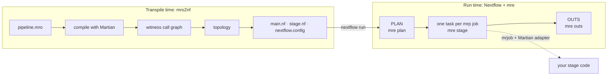

# Architecture overview

This page is the design record: the requirements mro2nf meets, the rules that
follow from them, and who owns what. It decides where new logic belongs. The
other architecture pages describe the mechanisms that implement it.

## Requirements

The project's requirements, as the maintainer stated them (2026-10-13):

> 1. The generated Nextflow runs and produces the same results as mrp,
>    including `pipeline_outs.json`.
> 2. It scales as Martian would.
> 3. Stage code is unchanged (the shim / stage ABI).

No run may require a shared filesystem (EFS, Fusion). A task reads what
Nextflow stages into it. The one exception is an entry input read in place,
which lies in a read-only namespace every task sees at one path: head-node
paths on the local and grid profiles, and the optional S3 mount on `awsbatch`
([Inputs](inputs.md)). Paths a stage hides in text, such as JSON, CSV or an
untyped `map`, are out of scope
([Files and paths](../user-guide/files-and-paths.md#paths-written-into-text)).

## The two contracts

Faithfulness means exactly two contracts:

1. **The stage ABI.** Each stage task receives `_args` and produces `_outs` in
   the byte shape the Martian adapter expects.
2. **Pipeline outputs.** A run publishes the same outputs as `mrp`, every run:
   in a deterministic order, stable under `-resume`, and with a loud failure
   rather than a silent divergence.

Everything between stage tasks (binding, forking, gathering, disabling,
staging) is an implementation choice. mro2nf implements it as idiomatic
Nextflow, not as a replica of Martian's orchestration.

## The overhead rule

Requirement 2 is the overhead rule: orchestration costs no more than the
pipeline's size plus its data, never more as fork width or chunk count grow.

- A run has PLAN, one task per job `mrp` runs, and OUTS.
- The plumbing task count does not change with fork width or chunk count.
- Each stage task stages only the upstream outputs its `_args` read, as an
  `mrp` job reads only those forks' outputs.

`make bench` and the nightly `make test-scale` enforce it
([Benchmarks](../development/benchmarks.md)), and
`TestStandInStagesOnlyWhatItReads` holds every fixture to the staging rule.

## Two programs



- **`mro2nf`** is the transpiler. It runs once, at build time, and writes the
  Nextflow project ([Transpile time](transpile.md)).
- **`mre`** is the runtime shim. Every task calls it
  ([The `mre` shim](mre.md)):
  - `mre plan`, in PLAN, compiles the run's real invocation;
  - `mre stage`, in each stage task, builds the stage's `_args`, runs the job
    as `mrp` runs it, and posts its outputs;
  - `mre outs`, in OUTS, lays out the published tree with `mrp`'s own
    post-processing.

## Who owns what

Nextflow owns orchestration. `mre` owns Martian's value semantics and the
stage ABI. The driver, the Groovy in `stage.nf` and `main.nf`, moves the
records `mre` wrote, joins them by key and looks values up in them. It computes
no Martian value and parses no JSON a stage controls.

| Concern | Owner | Where |
|---|---|---|
| Scheduling: a task per `mrp` job, executors, queues | Nextflow | the processes of `stage.nf`; the [profiles](targets.md) |
| Staging files between tasks | Nextflow `path` inputs; `mre` names each file to stage | `stage.nf`; [Bundles](bundles.md#files-by-reference) |
| Caching | Nextflow `-resume` | [Run time](runtime.md#cache-identity) |
| Retries | Nextflow `errorStrategy`, on the exit code `mre` chooses | `conf/base.config`; [`internal/job/retry.go`](../../internal/job/retry.go) |
| Resources | Nextflow `cpus`, `memory`, `accelerator`, `clusterOptions`; `mre` resolves the values as `mrp` | [Targets](targets.md#resources); [`internal/job/resources.go`](../../internal/job/resources.go) |
| Publishing | Nextflow workflow outputs (`publish:`, `output {}`), each file from the task that wrote it; `mre outs` lays out the tree | [Run time](runtime.md#outs) |
| Targets and launch parameters | Nextflow profiles and `params` | [Targets](targets.md), [Inputs](inputs.md) |
| Binding, projection, struct narrowing | `mre`, through Martian's functions | [`internal/cg/resolve.go`](../../internal/cg/resolve.go) |
| Types and file leaves | `mre` | [`internal/types`](../../internal/types), [`internal/shim`](../../internal/shim) |
| JSON fidelity | `mre`; the driver carries values as opaque records | [`internal/types/object.go`](../../internal/types/object.go), `cg.MaxValueBytes` |
| Stage ABI: `_args`, `_jobinfo`, `_outs`, the job | `mre`, `mrjob`, Martian's adapters | [`internal/job`](../../internal/job) |
| Forks, elements, gates | `mre` posts them; the driver joins by key | [`internal/cg/post.go`](../../internal/cg/post.go) |
| Pipeline outs | `mre outs`, through Martian's `PostProcess` | [`internal/cg/outs.go`](../../internal/cg/outs.go) |

### Why values stay in Go

Groovy's JSON reader, the one behind `-params-file` and
`groovy.json.JsonSlurper`, changes values silently. Measured on Nextflow
26.04.7, and against a real `mrp` run:

- `{"f": 1e6}` reads as the `BigDecimal` `1E+6`, which `JsonOutput.toJson`
  writes as `1E+6`. `mrp`, given `f = 1e6`, writes `"f": 1e+06` into the
  stage's `_args`.
- `{"n": 9223372036854775808}` (2^63) reads as the `Long`
  `-9223372036854775808`, and `9223372036854775807 + 1` wraps the same way.

So `mre` decodes every value with `json.Number`
([`internal/types/object.go`](../../internal/types/object.go)), which keeps a
number's bytes, and resolves it with Martian's own types. The driver carries a
value only as a base64 record `mre` wrote. The launch parameters are the one
place values cross Groovy's JSON: PLAN serializes them
([`internal/cgnf/plan.go`](../../internal/cgnf/plan.go)), and `mre plan`
re-encodes every float in them as `mrp` encodes a literal
([`cmd/mre/entryvalues.go`](../../cmd/mre/entryvalues.go)).

## Martian code reused

mro2nf reuses Martian rather than re-implementing it. Martian's code comes from
the module `go.mod` pins, `github.com/martian-lang/martian`. Four parts are
copies, each held to the module by a test: the adapters
(`vendor-martian/python`, byte for byte, `TestVendoredMartianMatchesModule`),
the retry patterns (`TestRetryPatternsMatchModule`), the job-manager
settings (`TestJobSettingsMatchModule`), and core's runtime resolution,
`internal/mrcore` (`TestMrcoreMatchesCore`).

| Martian | Used for | Call site |
|---|---|---|
| `syntax` `Parser.ParseSourceBytes`, `Ast.MakePipelineCallGraph` | compiling the invocation and its call graph | [`internal/cg/graph.go`](../../internal/cg/graph.go), [`internal/cg/source.go`](../../internal/cg/source.go) |
| `syntax` `ResolvedBinding.BindingPath`, `SplitExp.BindingPath` | specializing a binding or a split to a fork | [`internal/cg/resolve.go`](../../internal/cg/resolve.go), [`internal/cg/split.go`](../../internal/cg/split.go) |
| `syntax` each type's `FilterJson` | narrowing a value to its declared type | [`internal/cg/split.go`](../../internal/cg/split.go) |
| `core` `BuildDataForAst` | the invocation data | [`internal/cg/source.go`](../../internal/cg/source.go), [`internal/cg/graph.go`](../../internal/cg/graph.go) |
| `core` `BuildCallAst` | rebuilding the run's call from its parameters | [`internal/cg/source.go`](../../internal/cg/source.go) |
| `core` `ReadOverrides` | reading `mrp --overrides` | [`cmd/mre/run.go`](../../cmd/mre/run.go) |
| `core` `PipestanceOverrides.ApplyResourceOverrides` | each job's resources | [`internal/job/resources.go`](../../internal/job/resources.go), [`internal/job/overrides.go`](../../internal/job/overrides.go) |
| `core` `LazyArgumentMap.Path` | output projection | [`internal/cg/resolve.go`](../../internal/cg/resolve.go) |
| `core` `LazyArgumentMap.ValidateOutputs`, `MarshalerMap.ValidatePipelineOutputs` | output checks, in core's own `Fork.verifyOutput` and `Fork.verifyPipelineOutput` | [`internal/mrcore/stage.go`](../../internal/mrcore/stage.go) |
| `core` `Runtime.ReattachToPipestance`, `Pipestance.PostProcess` | the published tree and outs JSON | [`internal/cg/outs.go`](../../internal/cg/outs.go) |
| `core` `NewMetadata` | writing a job's metadata | [`internal/job/launch.go`](../../internal/job/launch.go) |
| `core` runtime resolution (`fork.go`, `resolve.go`, `runtime.go`, `node.go`, `stage.go`) | resolving one instance's inputs and forks, adapted to read what a task staged | [`internal/mrcore`](../../internal/mrcore) |
| `cmd/mrjob` | running `py` and `comp` jobs | `go.mod` `tool`; `Makefile` `build`; [`internal/job/launch.go`](../../internal/job/launch.go) |
| `adapters/python` | the `py` adapter, embedded in `mre` | [`vendor-martian`](../../vendor-martian), [`cmd/mre/tools.go`](../../cmd/mre/tools.go) |
| `jobmanagers/retry.json` `retry_on` | which failures are retried | [`internal/job/retry.go`](../../internal/job/retry.go) |
| `jobmanagers/config.json` `settings`, as `core` `JobManagerSettings` | each job's default resources and thread variables | [`internal/job/resources.go`](../../internal/job/resources.go) |

[`internal/mrcore`](../../internal/mrcore) is Martian core's runtime
resolution at the pinned commit, run over what one task staged in place of a
pipestance on disk. A fork's outputs come from a store of the task's staged
records, and an output read the task did not stage fails loudly rather than
reading as not yet ready. Every function, type, var and const it changes from
core is listed, with why, in `mrcoreAdapted`
([`test/thirdparty/mrcore_test.go`](../../test/thirdparty/mrcore_test.go)),
and `TestMrcoreMatchesCore` holds everything else to core's own source.

## No undocumented divergence

Every known difference from `mrp`, in a stage's `_args` or `_outs`, the
published tree, `pipeline_outs.json` or a run's outcome, is an entry of the
allowlist [`test/e2e/divergences.json`](../../test/e2e/divergences.json), with
its justification and the tests that prove it.

- The differential tests excuse a difference only through an entry.
- [Divergences](../reference/divergences.md) is generated from the allowlist
  (`make docs-divergences`), and `TestDivergencesDocIsCurrent` fails while it
  is stale.
- A difference with no entry is a bug.

## Source layout

```
cmd/mro2nf/      the transpiler CLI: .mro -> Nextflow project
cmd/mre/         the runtime shim: plan | stage | outs
internal/
  cg/            Martian's compiled call graph: witness, topology, plan,
                 the _args resolver, fork elements, gates, pipeline outs
  mrcore/        Martian core's runtime resolution, ported to read staged records
  cgnf/          call graph -> Nextflow project (main.nf wiring, stage.nf, configs)
  job/           runs one stage job through mrjob as mrp runs it
  types/         the type-directed file-leaf walk over Martian's compiled types
  shim/          bundle I/O, markers, output confinement
  fileio/        the file and record writers, with mrp's modes
```

Next: [Concepts](concepts.md).
