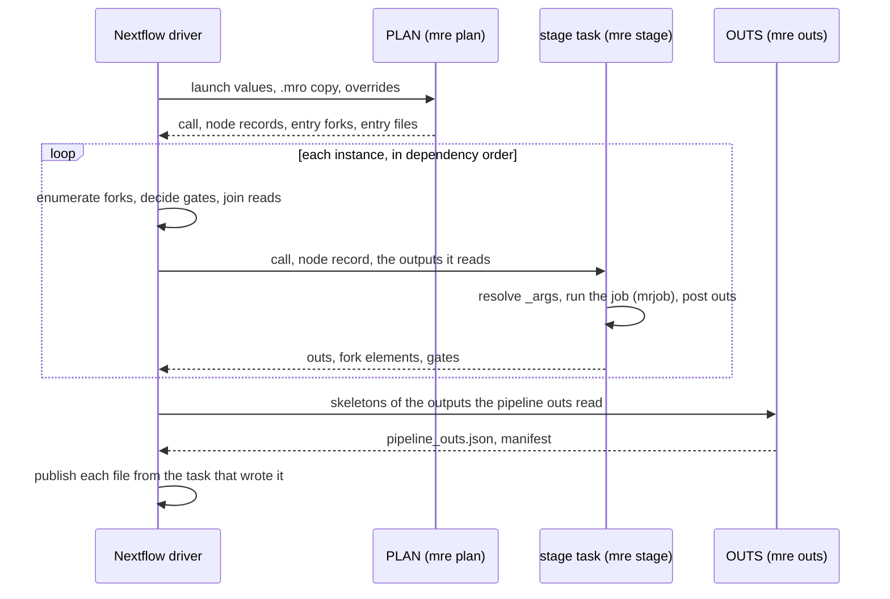
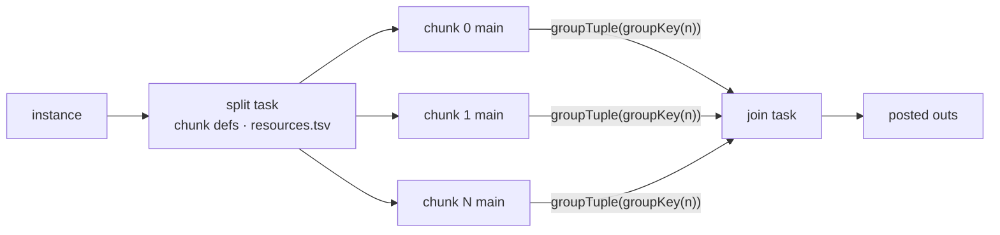

# Run time

A run has three kinds of task: PLAN starts it, one task runs per job `mrp`
would run, and OUTS ends it. The Nextflow driver wires them together by
joining the records `mre` writes.

## PLAN

One task starts every run. It stages the project's copy of the entry's `.mro`
files (`_assets/mro/`) and compiles it. `mre plan`:

1. overlays the run's entry parameters on the entry's invocation data (a
   string parameter of a scalar input is parsed as its type;
   [Inputs](inputs.md));
2. rebuilds the call as `mrp`'s invocation generator does (`core.BuildCallAst`);
3. compiles it over the entry's declarations, so `mrp`'s refusals fail the run
   before any stage starts;
4. fails if the call graph has a node, fork root or read the witness lacks
   (`Topology.Covers`); a node the invocation disables outright counts only by
   its presence.

Its records reach the driver as values: the run's call, an `eval` value of
one line, and files the driver reads into values (Nextflow joins an `eval`
output line by line in time quadratic in its lines):

- **per node**: a digest of its resolved spec (stage, bindings, disable
  bindings and fork roots, in Martian's JSON form) and of what its post step
  writes for its readers (the splits of the roots it feeds, its partners'
  splits, and the disable bindings whose value it posts with their roots);
  whether the invocation disables it; the fork keys a
  static per-fork binding disables; its resources under the run's
  overrides file; and the witness roots the invocation's node is not forked
  on, at which it runs once ([Transpile time](transpile.md#the-witness));
- **the entry files** the tasks stage ([Inputs](inputs.md));
- **in one record, the forks of every entry-fed root**, keyed by the witness's
  outer roots, each with its fork record and its index token. Each line leads
  with its root, and a node's wiring takes its root's own lines from it
  (`ENTRY_ROOT`, a lookup by root);
- **the pipelines' version**, an `eval` value, found once, as `mrp` finds it
  at its start (`git describe` or a `.version` file), on the include path the
  stage tasks find the code on, not on PLAN's copy of the `.mro` files. Every
  job's `_jobinfo` records it, so a commit during a run or across a `-resume`
  gives no two tasks different versions.

## Cache identity

A task's `-resume` key holds what can change its result, so a changed input
re-runs it and an unchanged one does not. Two choices widen a key on purpose:
every stage task keys on the whole call, as `mrp` refuses to resume a changed
invocation, and PLAN does not cache under an S3 mount.

**PLAN** caches on the entry values, the `.mro` copy, the overrides file, and
its `meta`, which carries the launch parameters it reads and the run's work
directory. Under an S3 mount it does not cache, since which `s3://` inputs it
reads in place depends on the buckets its instance mounts
(`TestResumeRechecksTheS3Mount`).

**A stage task's** key holds:

- its own node's spec digest and resources (in `meta`);
- the run's call;
- the mro2nf build;
- its fork records, value records and staged directories;
- the launch parameters its script reads, which its `meta` carries as its
  `run` entry.

No script reads `params` directly (`TestScriptsReadParamsFromMeta`): Nextflow
26.04 keys no task on a parameter read by a function its script calls, as the
stage module's are, and 26.04.0–26.04.1 on none its script reads
(nextflow-io/nextflow#7156), so a changed parameter would silently reuse a
stale task. Nor does a process read a global such as `workflow.workDir` or
`projectDir`, which no task's key holds on the v2 parser
(`TestProcessesReadNoPathGlobal`).

No task stages a file of PLAN's: the digests reach it as values, which
Nextflow keys on by content.

**The run's call** reaches each task by one rule (`CALL`): a call whose base64
is at most 4 KiB (`cg.MaxValueBytes`) is a value each task's script writes
into `call.b64`, as on AWS Batch a staged file costs each task a download; a
larger one is a file the driver writes once per run
(`collectFile`), in a directory named by the call and the run's session, which
each task stages. The call grows with the entry values, so with N entry forks
an inline call would grow every task's script by O(N) bytes. A task still reads
the whole call, as `mrp` writes the whole invocation into every job's
`_jobinfo`, and keys on it, as `mrp` refuses to resume a changed invocation.

What re-runs after a change:

| Change | Re-runs |
|---|---|
| an entry value | every task (the call changed) |
| `--mro2nf_psid` | every task (`TestResumeKeysOnTheParamsATaskReads`) |
| `--mro2nf_monitor` | every stage task and OUTS (`TestResumeKeysOnTheParamsATaskReads`) |
| a `.mro` edit that leaves a node's spec and the call as they were | PLAN only; the node stays cached (`TestResumeKeysOnlyOnATasksOwnTypes`) |
| a `.mro` edit of how a consumer splits or gates on a node's outputs | the node too, since its post writes differently (`TestResumeKeysOnTheReadersAPostWritesFor`) |
| the overrides file | each node whose resources it changes, a split stage's split included, which writes the table its chunks and join are scheduled by (`TestResumeKeysOnANodesOverrides`) |

## Code drift

A stage task compiles the run's call over the entry `.mro` where the run finds
its code: its includes and its stages' code resolve beside it, as under `mrp`.
`mre stage` fails the task when the node compiles to another spec than the
digest PLAN planned (`cg.ErrSpecDrift`). A `.mro` edited since the transpile,
or an image built from other sources, fails loudly rather than run.

## Instances

An instance's key is its ordinal of each of its roots' forks. The driver
enumerates a node's instances root by root:

- an **entry-fed** root's forks come from PLAN;
- a **stage-fed** root's forks come from the elements its producer posted:
  `forks/<root>/<ordinal>/` directories and their value records;
- each instance joins the forks agreeing on the outer roots.

An element of a type that holds no file leaf, whose JSON is at most
`cg.MaxValueBytes`, reaches the instance as a value record, by the same rule
and with the same bytes as an output does ([Reads](#reads)); any other is
staged.

**Zips.** An instance zipping a stage output over a root other than the root's
own source joins that stage's partner element at its own fork's token,
whether that stage feeds the root or not, or the absent record, so each fork gets one element of it whatever the fork width
(the `zip` bench lanes hold the bytes one task stages flat in N). The same
holds for:

- a split of an output of a stage a runtime gate disables, `split Q.o unless
  G.f`: the instance reads the gate, and `Q`'s element only where the gate
  holds `Q` enabled (the `zipgated` lanes);
- a disable binding splitting another stage's output over an entry-fed root,
  `disabled = split FLAGS.skips`: the driver gates on what `FLAGS`'s post
  posted, and an enabled instance resolves the binding again from its one
  element (the `forkdisabled` lanes).

## Preflights

As in `mrp`, each instance waits until every instance of each preflight it is
gated by is done. A pipeline's preflights gate every other call in it, and,
through a sub-pipeline call, every call within, its preflights too
(`preflight_order`). A disabled preflight instance counts as done, and a
failing one ends the run before the calls it gates start (`preflight_fail`).

The wait is on PLAN's node records, which every instance's gate reads
(`GATE`). `AFTER` holds them until a preflight is done, once per set of
preflights some node waits for, each set after the one it extends, and a node
gates on the records held for its own. Nextflow adds each edge of its DAG in
time linear in the edges before it, so a wait per node, which cost Cell Ranger
three edges per node and preflight, would make the launch quadratic in the
nodes. This costs a few edges per preflight (`TestEmitWaitsOncePerPreflight`).
`TestLaunchEdges` bounds the edges `-preview` builds for a wide pipeline and
`cellranger_shaped`, so one edge more per data dependency fails it.

## Gates

A node's gates are decided on the driver, from PLAN's record and each gating
stage's posted `gates` (an `eval` output), joined on the roots they share.

- Each is parsed once into a set of the fork keys or gate tokens it disables:
  PLAN's per node (`NODES`), and a gating instance's however many nodes it
  gates (`GATES`). So an instance's gate is a lookup, not a scan of its node's
  N forks.
- `GATE` keys each instance by its ordinals of the roots of the stage its
  node's first gate joins on, and a gate is one `combine` (`GATED`), which adds
  the gates that stage posted there.
- `REGATE` keys the instance again, deciding it from the gates so far
  (`disabled`), only before a gate joining on other roots, and `ENABLED`
  decides it from the last. A map per gate to key the instance cost Cell
  Ranger 831 edges of its DAG.

A disabled instance runs no task and stands in with no outputs and no forks;
Martian's call graph already reads its outputs as null in every consumer.

## Reads

An enabled instance gets, of each node it reads, only the outputs it reads:
from the instance that shares its roots, or, for a gather, from every such
instance under it.

- A node's outputs are keyed by its whole key, which an instance sharing every
  root of it holds, so `READ` combines the node's outputs channel as it comes.
  A step keying or selecting them per read cost Cell Ranger 1,263 edges of
  Nextflow's DAG, whose launch is quadratic in its edges.
- An enabled instance leads with its ordinals of the roots its node's first
  read joins on (`ENABLED`), and a read is one `combine`, which adds the
  node's outputs after what the instance read before.
- `REKEY` keys the instance again only before a read joining on other roots,
  and the process's `INPUT` picks the outputs each read reads, so a run of
  reads on the same roots costs no map per read; a map per read cost Cell
  Ranger 2,439 edges more.

**Values and bundles.** An output of a type that holds no file leaf, whose
JSON is at most 4 KiB (`cg.MaxValueBytes`), reaches the reader as a value: a
record its producer posted (`-field-values`), an `eval` output, that the
driver carries in its channels and the task writes into a file for `mre stage
-values`, so the record is part of the task's `-resume` key. Any other output
is staged as a bundle (`outs/<output>/`).

The bound trades two costs: a staged bundle costs each reader on an object
store a listing and a copy whatever its size (on the Cell Ranger Batch run,
287 of 896 downloads were such outputs), while a value costs the driver its
bytes per instance until its readers are done.

**Gathers.** A gather is a seeded `groupTuple` over all of its upstream, so an
instance under which there is none gathers none. A forked instance waits for
every fork of the node it reads, as `mrp` waits for every fork of a node
before a node reading it runs (`martian/core/node.go` `getState`;
`TestEmitForkedGatherWaitsForItsUpstream`).

Files that outputs name move between tasks by reference:
[Bundles and file flow](bundles.md#files-by-reference).

## Split stages

- A split's outputs are joined once to the instance its task staged, by the key
  both hold (`SPLITS`), and its chunks' mains and its join read that join.
  Joining them anew for each, through a map of either side, cost Cell Ranger 6
  DAG edges per split stage.
- A split's chunk outputs are grouped by `groupTuple` over a `groupKey` of the
  chunk count, which joins a split as soon as its chunks are in, with
  `remainder: true`, so a group that numbers otherwise reaches the driver's
  check of its size and fails the run (`TestJoinFailsOnAChunkCountMismatch`).
  Nextflow's `groupBy` would check the size itself, but takes time quadratic in
  a group's size (`TestGroupingScalesLinearly`).
- Each chunk's main and the join are scheduled with the cpus, memory and
  special their jobs get, from the split's `resources.tsv`, a file the driver
  reads into rows without parsing a record, not an `eval` value, whose
  collection is quadratic in its lines.
- A split's chunk mains and join stage the split's inputs, the same instance
  tuple, and build its args again.

## OUTS

The last task lays out what the run publishes without the bytes of any file a
stage task wrote (#610).

1. It stages the skeleton of every outputs bundle the pipeline outs read, and
   of every bundle holding a file they name by reference (`skeletons`,
   `refBundles`), never the bundles themselves
   ([Skeletons](bundles.md#skeletons)).
2. It gets each bundle's location as a value (`toUriString()`, a path or an
   `s3://` URI), the outputs that reach it as values, and stages the entry
   files the pipeline outs read.
3. `mre outs` expands the skeletons and runs `mrp`'s own post-processing over
   them, which reads only paths, never bytes.
4. It emits `pipeline_outs.json` (`json`) and a manifest of the `outs/` tree
   (`manifest`), each entry its path in the tree and where the task that
   wrote it keeps it.

The entry workflow publishes both as its workflow outputs:
`pipeline_outs.json`, and each manifest entry from its source to its path
(`published`: `file(source) >> path`), copied into Nextflow's `outputDir`
(`results` by default, `-output-dir` or a config's `outputDir` elsewhere, the
HealthOmics pubdir under that profile). So each file a stage task wrote is
copied once, by the driver, from where its producer wrote it, server side
between two `s3://` prefixes, and no other task stages or uploads it (the
bench's publish gate).

Two Nextflow details shape this:

- Nextflow 26.04 publishes no file outside a task's work directory: it logs a
  `NullPointerException` in `PublishOp.publish0` and the run succeeds without
  the file. So a published file no stage task wrote, an entry file or a host
  path a stage passed on, OUTS copies into its own `external/` directory, which
  the manifest names, and the run publishes it from there
  (`TestMrpDiffPublishesHostEntryFiles`). It is a copy, not Nextflow's default
  symlink, so an object-store or HealthOmics output directory holds the files
  themselves, dotfiles and empty directories included.
- A `-preview` run publishes nothing (`enabled !workflow.preview`): it runs no
  task, and Nextflow 26.04 to 26.10 then waits forever on an enabled output's
  channel.

## Order

Each staged list, and each list of value records, is in an order the run
fixes: a gather's and OUTS's by instance key, then output, and a join's by
chunk name. List order is part of a task's `-resume` key, and arrival order is
completion order, so nothing is left in arrival order.

## Overhead

The tasks are PLAN, one per stage job `mrp` runs (each split, chunk and join of
a split stage, one per fork of a non-split stage), and OUTS. Binding, forking,
gating and gathering run inside those tasks or on the driver, so the plumbing
task count does not grow with fork width or chunk count (`make bench`,
`make test-scale`; [Benchmarks](../development/benchmarks.md)).

Next: [The `mre` shim](mre.md).
