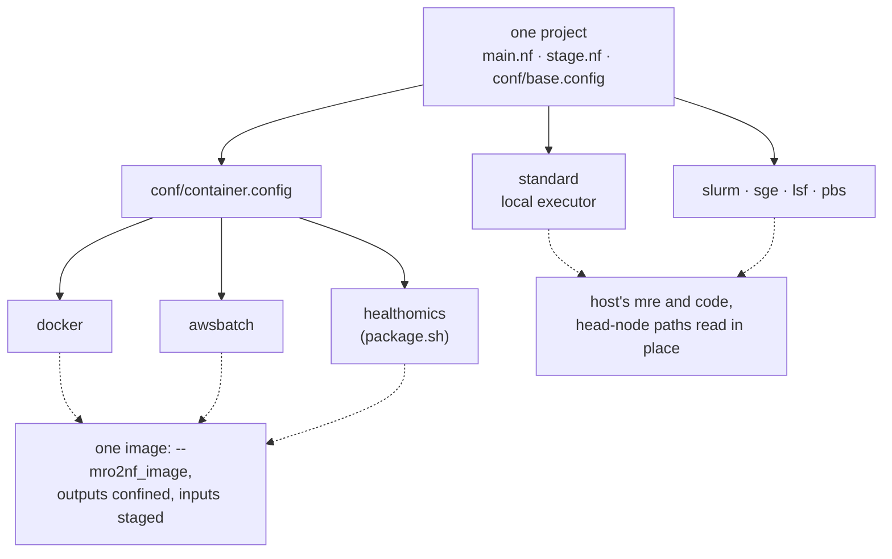

# Targets

Targets are profiles of one project (`nextflow run -profile <name>`). The `.nf`
files are the same everywhere; a profile sets only which executor runs the
tasks, in which image, and how jobs are granted resources. Every task finds
`mre` on `PATH`. [Profiles](../user-guide/profiles.md) is the user-facing
guide.

## Profiles

- **Where the code is.** Every profile finds the code where the project was
  transpiled from: a stage task compiles the entry `.mro`, its includes and its
  stages' code at their absolute transpile-time paths. PLAN and OUTS compile
  the project's `.mro` copy and need no code.
- **`standard` and the grid profiles** (`slurm`, `sge`, `lsf`, `pbs`) run the
  host's `mre` and code, on a shared filesystem, where every task reads a
  head-node entry file in place ([Inputs](inputs.md#head-node-paths-read-in-place)).
  Nextflow applies `standard` to a launch that names no profile, so a run
  without `-profile` is local.
- **The container profiles**, `docker`, `awsbatch` and `healthomics`, include
  `conf/container.config`: outputs confined to the task
  ([Bundles](bundles.md#symlinks-and-confinement)), a head-node entry file
  staged, and every task, PLAN and OUTS included, in the one image
  `params.mro2nf_image`. They set `params.mro2nf_require_image`, so a launch
  without an image fails before PLAN.
- **`docker`** runs each task in a container that mounts only what it stages.
- **`awsbatch`** runs on AWS Batch over an S3 work directory (`-work-dir
  s3://…`). Every task stages its upstream inputs from S3, so nothing reads a
  head-node path, and a head-node path as an entry file is refused. It reads an
  `s3://` entry file in place under `/mnt/s3` (`params.mro2nf_s3_mount`), the
  root it bind-mounts read-only into every container (`aws.batch.volumes`),
  where the compute environment's instances mount the file's bucket
  ([Inputs](inputs.md#mounted-s3-values)), and stages it otherwise.
- **`healthomics`**: `./package.sh <image>@sha256:…` zips the files `main.nf`
  reads with a `nextflow.config` of its own: the engine floor,
  `conf/base.config`, the image and `conf/healthomics.config`, so the profile
  is the workflow's own. It sets `outputDir` to `/mnt/workflow/pubdir`, the
  directory HealthOmics exports.

### Why the HealthOmics package has no profiles

HealthOmics applies `standard`, if the workflow defines it, to a run that names
no profile. `standard` is the local target, whose `process.resourceLimits`
would clamp every task to the engine's host and whose `mro2nf_local_jobs` would
grant jobs as `mrp`'s local job manager does (#571).

Under Nextflow 26.04 a top-level setting after the profiles does override a
profile's, and `= null` unsets one (`nextflow config -flat`). But undoing
`standard` that way would have to name each of its settings, and one added
later would reach HealthOmics runs unnoticed. A config without the profiles has
nothing to undo. The package sets no executor; HealthOmics runs every task
itself.

The image must be pinned by digest: a workflow version then runs the code it
was validated with, and as `parameter-template.json` declares only the entry
inputs and `mro2nf_overrides`, no run can name another image.

## The runtime image

[`deploy/runtime/Dockerfile`](../../deploy/runtime/Dockerfile) puts `mre` and
the `mrjob` beside it on the image's `PATH` at `/opt/mro2nf`, published as
`ghcr.io/eunmann/mro2nf-runtime:<version>` by each release. The user's image
builds `FROM` it and adds the pipeline's code at the paths the project was
transpiled from ([Container images](../user-guide/container-images.md)); a
stage `src` that names a command must be on the image's `PATH`. The runtime
image itself serves where a `-c` config mounts the code at those paths.
`mre stage` refuses a node the image compiles to another spec than PLAN
planned ([Run time](runtime.md#code-drift)), so a stale image fails loudly.

## Resources

- **Requests.** A stage's `using (threads = …, mem_gb = …)` is its jobs'
  request; a chunk and a join take the resources the split returned for them.
- **Grants.** Each job is granted its request as `mrp` grants it in the
  jobmode the profile runs as
  ([`job.Runtime.Resources`](../../internal/job/resources.go)):
  - on `standard` and `docker`, `mrp`'s local job manager's grant from a pool
    of `process.resourceLimits`' cpus and whole GB of memory, which PLAN and
    every stage task pass `mre` from their own task (`-local-cores`,
    `-local-mem-gb`), so an adaptive request gets the pool, and every request
    but vmem at most the pool;
  - elsewhere, `mrp`'s cluster job managers' grant: a request at its magnitude
    in whole threads.
- **What reports the grant.** `_jobinfo`, `__threads`, `__mem_gb`,
  `__vmem_gb` and the thread variables report the grant, and the task requests
  its threads rounded up as `cpus` (at least 1) and its memory as `memory`.
- **Overrides.** `--mro2nf_overrides <file>` is `mrp --overrides`: PLAN reads
  it, and every job's threads, memory and vmem resolve under it as `mrp`'s
  (`core` `PipestanceOverrides.ApplyResourceOverrides`), over `using` and the
  split's request, into its task's `cpus` and `memory`, `_jobinfo` and `_args`.
  The driver parses none of it: each task gets its node's resources and own
  overrides file as values of PLAN's record, and a chunk and the join take
  theirs from the split's `resources.tsv`. `force_volatile` and `*.profile`
  change no output and have no effect.
- **The local pool.** On the `standard` and `docker` profiles,
  `process.resourceLimits` is the host's cpus and 90% of its memory, and clamps
  each task, so a `withName:` request larger than the host runs rather than
  fails; a `-c` config setting `process.resourceLimits` sets another pool.
  Without a cgroup cpu quota or memory limit that is `mrp`'s default
  `--localcores` and `--localmem`; under one, the JVM counts the quota's cpus
  where `mrp` counts every cpu in its affinity mask (`runtime.NumCPU`), and
  `mrp` may take 96% of the limit.
- **`special`.** A job's special, the stage's or the `__special` its split
  returned, selects `params.job_resources[special]` as the task's
  `clusterOptions`; `special = "gpu"` or `"gpu:N"` also requests N GPUs for that
  job.
- **Retuning.** A `-c` config with `withName:` selectors on the node aliases
  retunes one stage at launch.
