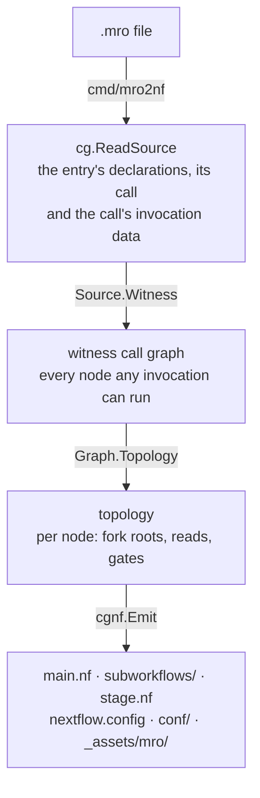
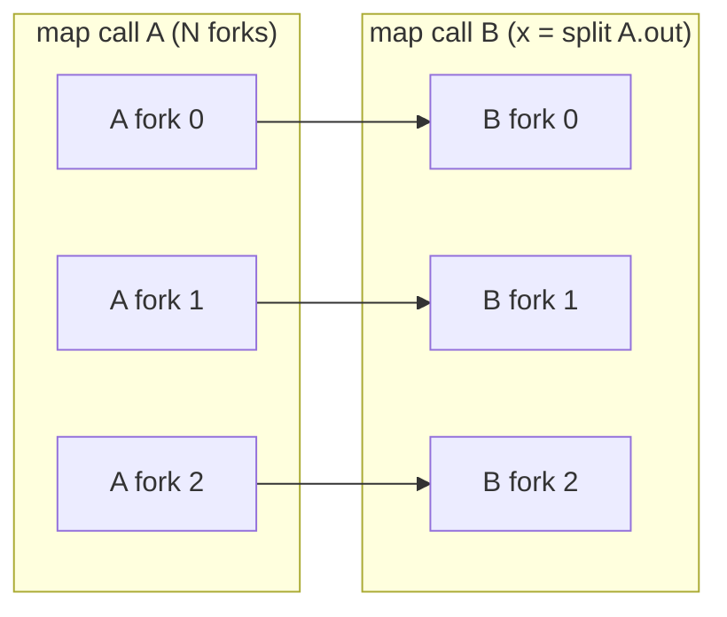

# Transpile time

`mro2nf` turns a `.mro` into a Nextflow project in four steps. It does not
re-implement Martian's grammar: it compiles the pipeline with the upstream
`martian/syntax` package, as `mrp` does.



Compiling the call graph (`MakePipelineCallGraph`) is the step `mrp` runs
before it creates a pipestance. So a pipeline `mrp` refuses to start is refused
at transpile time with `mrp`'s message, and no project is written.

The CLI ([`cmd/mro2nf/main.go`](../../cmd/mro2nf/main.go)) takes `-o`,
`-mropath` and `-version` ([Transpiling](../user-guide/transpiling.md)).
`-mropath` defaults as `mrp`'s `cmd/mrp/configure.go` computes it: `$MROPATH`
when set, else the `.mro`'s directory, never the working directory. As in
`mrp`, the entry's own directory is searched first for the entry's includes
and its stages' code only: every compile of the run's invocation, in the
transpiler and in each task, compiles it as the entry file. Everything else is
a launch parameter of the project.

## The witness

A transpile cannot know a run's invocation, since its inputs are launch
parameters. So it compiles a *witness* invocation
([`Source.Witness`](../../internal/cg/source.go)):

- every entry input takes a value of its type;
- every collection has two elements, and nested collections have different
  lengths;
- every bool is `false`, and nothing is null.

No map call is pruned on an empty or null source and no call is disabled by an
entry value, so the witness's call graph holds every stage node, with its fork
roots, of any invocation.

Where `mrp` refuses the witness, the inputs start from the literal invocation,
and each in turn takes its witness value only while `mrp` still accepts the
call; a panic of Martian's call-graph builder counts as a refusal.

The transpile refuses a `.mro` whose own invocation is not within its
witness's (`Source.CoversLiteral`), and at run time PLAN checks the real
invocation the same way (`Topology.Covers`): a node, fork root or read the
witness lacks fails before any stage starts ([Run time](runtime.md#plan)). A
read is within the witness's when the witness's read patterns give every
instance it reads, at the invocation's fork counts: Martian expands an entry
collection into a literal of its width, and at one fork an alignment selects
what a limit to ordinal 0 does. The witness's own patterns don't depend on its
width (`mergePatterns`). Some invocations remain outside the witness (#621).

## The topology

[`Graph.Topology`](../../internal/cg/topology.go) reduces the witness call
graph to what tasks exchange:

- **per node**: its fork roots, the outputs it reads of other nodes, the nodes
  whose outputs gate it, and the preflights it waits for;
- **per fork root**: what feeds its forks (the entry, or one stage) and the
  outer roots its forks vary with.

Nodes are in dependency order: each follows every node it reads, the producers
of its fork roots, and its gates.

### Which stage feeds a fork root

The stage that feeds a root's forks is the one whose outputs fix their count.
mro2nf finds it by walking Martian's compiled split source case for case, as
`mrp` expands forks from it (`core/fork.go` `expandForkPartFromSource`):

- for a map call over another map call's outputs, the source set's master;
- for a gated literal, the gate's stage;
- the gated stage itself, where the gate disables that stage too.

### What each node reads

Each instance stages exactly the upstream instances its `_args` read, as an
`mrp` job reads only those forks' outputs (#601). A node's read of another
carries read patterns ([`ReadPattern`](../../internal/cg/align.go)), one per
shape of the references to it:

- **Alignment.** A pattern aligns an upstream root the reader is not forked on
  with a reader root, where every reference under a split over that root sits
  at its element's own index of the upstream root. Martian expands a split
  over a map call's outputs into a literal or a merge of its forks, in order,
  so fork *i* of the reader reads fork *i* of the upstream.
- **Gathering.** The upstream's other roots it gathers: all of their forks.
- **Limiting.** Where a split's elements do not all read the upstream, the
  pattern is limited to the elements that do.

The driver joins an instance on the shared and aligned roots' ordinals
(`READ`, or `GATHER` under them) for one unlimited pattern, and otherwise
through `NEEDS`, a keyed join per pattern regrouped per instance.



### Merges

A merge's reads include what counting the forks it gathers reads
([`Graph.countReads`](../../internal/cg/graph.go), the walk `mrp`'s fork
expansion makes), at the outer fork the merge's constraint fixes. Those forks
are the ones `mrp`'s `getParts` takes
([`Graph.mergeCounted`](../../internal/cg/merge.go)):

1. the merged call's, where the node the merge is bound to has a root on that
   call;
2. otherwise, when Martian does not know the call's length, the forks of the
   bound node's single root, if it has exactly one and the reader is not
   forked on it (#613);
3. in every other case, none.

A merge that is the collection a split over the reader's own root forks is not
counted: its element there is the one merged fork at the reader's index, which
the instance reads alone, as its `_args` hold it (#614).

### Gates and refused shapes

A disable binding forked on a map call its gating stage feeds, such as
`disabled = self.item.skip` under `map call X(item = split SRC.items)`, has a
value per fork of that call. The gating stage's post step resolves it at each
fork and posts the forks it disables (`split_gate`), and does the same when the
entry forks that call (`split_gate_entry`).

A shape whose data the tasks cannot exchange is refused at transpile time:

- a fork root several stages feed;
- a disable binding that reads several stages;
- a disable binding forked on a map call another stage feeds.

## The generated project

```
main.nf               the params block, PLAN, the nodes or the calls of their
                      workflows, then OUTS and the workflow outputs
subworkflows/         a workflow per run of nodes (W<j>.nf), only in a project
                      too large for one
stage.nf              the one hand-written stage module every node includes
nextflow.config       the engine floor, conf/base.config, the target profiles
nextflow_schema.json  every parameter's type, default and description (nf-schema)
conf/                 base.config: parameters, retry policy, GPU requests, trace;
                      the container and HealthOmics profiles' configs
package.sh, parameter-template.json   the HealthOmics package
_assets/mro/          a copy of every .mro the entry compiles from, each at its
                      absolute path below it; PLAN and OUTS compile it
```

[`internal/cgnf`](../../internal/cgnf) writes it: `main.nf` and the
sub-workflows from the topology, and `stage.nf` copied as is from
[`internal/cgnf/assets/stage.nf`](../../internal/cgnf/assets/stage.nf).

### `stage.nf`

`stage.nf` declares the processes:

| Process | Runs |
|---|---|
| `STAGE` | a stage that does not split: one task per instance |
| `STAGE_SPLIT`, `STAGE_MAIN`, `STAGE_JOIN` | a split stage's three phases |
| `OUTS` | the last task, which lays out the published outputs |

The workflow that wires a node includes them once under its own alias, so a
`withName:` selector names the node. For `testdata/split_test`:

```groovy
include { STAGE_SPLIT as N0_SUM_SQUARES_SP ; STAGE_MAIN as N0_SUM_SQUARES_MN ; STAGE_JOIN as N0_SUM_SQUARES_JN } from './stage.nf'
include { STAGE as N1_REPORT } from './stage.nf'
```

Every stage task runs one `mre stage` call ([The `mre` shim](mre.md)), which
compiles the call graph once and runs the phase's job as `mrp` runs it.

Each stage process declares one output. A posting process (`STAGE`,
`STAGE_JOIN`) emits its outputs, forks and gates as one tuple (`posted`),
since Nextflow's DAG holds an edge per declared output whether a node reads it
or not: 602 of Cell Ranger's edges were outputs no node read.

`stage.nf` also holds the wiring: sub-workflows that read PLAN's records
(`NODES`, `ENTRY`, `ENTRY_FORKS`, `ENTRY_ROOT`) and that take a node's
instances through each step of it (`FORK`, `ZIP`, `GATE`, `ENABLED`, `READ`,
`GATHER`, `INPUT`, `CHUNKS`, `JOIN`, and others). Each is given the node's
static data, so a node's wiring in `main.nf` is a few lines: one per root,
read or gate. The generated `main.nf` for `split_test`:

```groovy
// SUM_SQUARE_PIPELINE.SUM_SQUARES
b0 = ENABLED(GATE(channel.of([[], [], [], []]), nodes, [node: 'SUM_SQUARE_PIPELINE.SUM_SQUARES', special: ''], []), [], [])
s0 = INPUT(b0.run, [])
N0_SUM_SQUARES_SP(s0)
x0 = SPLITS(N0_SUM_SQUARES_SP.out.split, s0)
N0_SUM_SQUARES_MN(CHUNKS(x0))
j0 = JOIN(x0, N0_SUM_SQUARES_MN.out.chunk)
N0_SUM_SQUARES_JN(j0)
r0 = JOIN_SOURCES(j0)
o0_outs = POSTED(N0_SUM_SQUARES_JN.out.posted, b0.skip, r0, 1)
// SUM_SQUARE_PIPELINE.REPORT
b1 = ENABLED(GATE(channel.of([[], [], [], []]), nodes, [node: 'SUM_SQUARE_PIPELINE.REPORT', special: ''], []), [], [])
u1 = READ(b1.run, o0_outs)
n1 = INPUT(u1, [['sum']])
N1_REPORT(n1)
```

The driver runs only those sub-workflows and a few Groovy helpers (`ordered`,
`resources`), which read only records `mre` wrote. It parses no JSON a stage
controls.

### Workflows

The JVM compiles each workflow's statements into one method, which may not
pass 64 KiB of bytecode, and a call into one of at most 255 arguments. Only
those limits shape the workflows; the `.mro`'s pipeline nesting does not.

- `main.nf`'s entry workflow wires every node, in the call graph's dependency
  order, beside PLAN and OUTS.
- When the nodes weigh more than one workflow holds (`maxWeight`), they are
  cut, in that order, into runs. Each run is filled until the next node would
  make it weigh more than `maxWeight` or take more than `maxTakes` channels,
  and becomes a workflow `W<j>` of its own (`subworkflows/W<j>.nf`), which the
  entry workflow calls in turn. Were the calls of the runs themselves too
  heavy, runs of those runs are cut the same way
  ([`internal/cgnf/scope.go`](../../internal/cgnf/scope.go)).
- A run takes the channels its nodes read from outside it, emits those read
  outside it, and emits `outs_pub`: one channel that mixes the outputs bundles
  of its own nodes the pipeline outs read (`PUBLISHED`). The entry workflow's
  `outs_pub`, which mixes its own nodes' bundles with its runs' `outs_pub`, is
  OUTS's input, which `ordered` sorts by node and instance key, so where a
  bundle is mixed does not change it, and no workflow mixes more sources than
  it has calls.
- PLAN declares the same outputs, and the entry workflow has the same few
  statements of them, however many entry-fed roots a pipeline has, as PLAN
  writes all their forks as one record.

So no workflow grows with the pipeline (`TestEmitBoundsEveryWorkflow`,
`TestEmitBoundsPlan`, `TestWidePipelineRuns`, `TestEntryRootsMatchMrp`).

A process's trace name is its alias, `N5_X`, in the entry workflow, and
`W1:N5_X` in a run; a `withName:` selector of the alias alone names it in
either. Nextflow's task hash includes that name, so `-resume` finds no cached
task of a node that a re-transpiled project wires in another workflow than the
run did.

### The configs

`nextflow.config` declares the oldest Nextflow the project runs on, includes
`conf/base.config`, and defines the target profiles, whose settings override
the shared ones ([Targets](targets.md)). `conf/base.config` holds:

- **`params.job_resources`**, Martian's `MRO_JOBRESOURCES` analog: a map from
  a stage's `special` key to the `clusterOptions` of a grid executor.
- **The tools and options** the stage module reads: `mro2nf_mre`,
  `mro2nf_mrjob`, `mro2nf_adapters`, `mro2nf_psid` (PLAN refuses a psid `mrp`
  refuses: letters, digits, `-` and `_` only), `mro2nf_monitor` and
  `mro2nf_confine`. Every task runs the `mre` on `PATH`, and `mre` runs the
  `mrjob` beside its own binary, as `mrp` runs the `mrjob` beside its own, so
  the project names no host path of the tools.
- **The input options**: `mro2nf_host_inputs` and `mro2nf_allow_remote_inputs`
  (which entry file values a run may read), `mro2nf_host_in_place` (whether
  every task reads a head-node path in place; the container profiles turn it
  off), and `mro2nf_s3_mount` ([Inputs](inputs.md)).
- **The container options**: `mro2nf_image`, the one image the container
  profiles run every task in, which they require (`mro2nf_require_image`).
- **`mro2nf_overrides`**, the run's `mrp --overrides` file, and
  **`mro2nf_local_jobs`**, which the `standard` and `docker` profiles set to
  grant each job as `mrp`'s local job manager does ([Targets](targets.md#resources)).
- **One `params.<name> = null` per entry input** ([Inputs](inputs.md)).
- **The retry policy**, `mrp`'s: a task is retried, up to twice, only on exit
  75 or on an executor kill or timeout (104, 130–145), at the memory and cpus
  of its first attempt.
- **One `accelerator` rule**, evaluated per task, that requests N GPUs for a
  job whose `special`, as `mrp` resolves it, is `"gpu"` or `"gpu:N"`.
- **Task tracing.**

A boolean option is a `Boolean` of `main.nf`'s params block, which Nextflow
converts a launch's `--<name> true|false` to and refuses any other value as,
so a script reads it as the boolean it is.

Next: [Run time](runtime.md).
