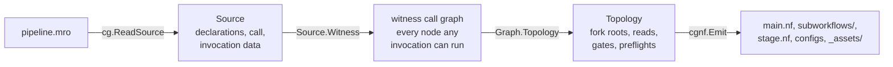
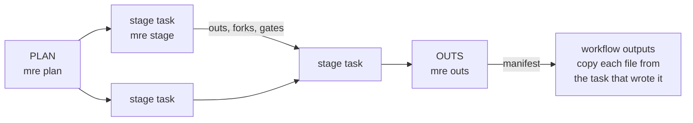
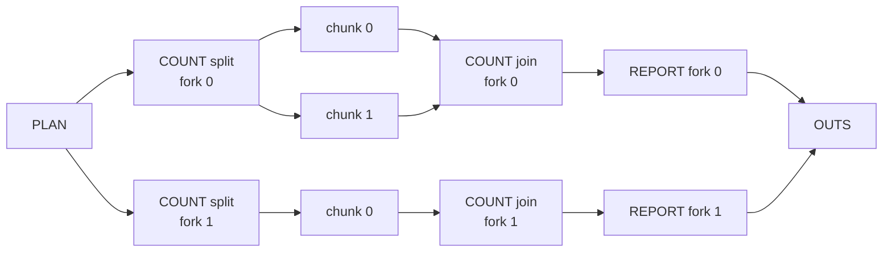

# How mro2nf works

mro2nf is two programs. `mro2nf` turns a `.mro` into a Nextflow project once.
`mre` runs inside every task of a run: it builds a stage's inputs, runs the
stage as `mrp` runs it, and hands its outputs back to Nextflow. This page
explains each mechanism and links to the code that implements it.

## The contract

Faithfulness means two things:

1. **The stage ABI.** Each stage job receives `_args` and writes `_outs` in the
   byte shape Martian's adapter expects, with the `_jobinfo` `mrp` writes.
2. **The outputs.** A run publishes the same `outs/` tree and
   `pipeline_outs.json` as `mrp`, on every run, in a fixed order, stable under
   `-resume`, and fails loudly rather than diverge.

Everything between stage jobs (binding, forking, gathering, disabling,
staging) is free to be ordinary Nextflow: channels, joins and `path` inputs.
mro2nf does not replicate Martian's orchestration. It does reuse Martian's code
for every value Martian decides, so it never re-derives one.

| Concern | Owner |
|---|---|
| Scheduling, staging, caching, retries, publishing | Nextflow |
| Which stage runs where, and which outputs each instance reads | the topology `mro2nf` computes ([`internal/cg/topology.go`](../internal/cg/topology.go)) |
| Binding, projection, forks, gates, types, `_args`, `_outs`, `_jobinfo` | `mre`, through Martian's own functions |
| JSON values | `mre` only; the driver carries them as opaque base64 records |

The driver, the Groovy in `main.nf` and `stage.nf`, joins records by key and
looks values up in them. It parses no JSON a stage wrote, because Groovy's JSON
reader changes numbers (`1e6` becomes `1E+6`; 2^63 wraps). `mre` decodes every
value with `json.Number` ([`internal/types/object.go`](../internal/types/object.go)).

## Transpile time

**Compile.** [`cg.ReadSource`](../internal/cg/source.go) parses the entry and
[`Graph`](../internal/cg/graph.go) builds its call graph with Martian's
`syntax` package, the step `mrp` runs before it makes a pipestance. A pipeline
`mrp` refuses is refused with `mrp`'s message.

**Witness.** The run's inputs are launch parameters, so the transpile cannot
know the invocation. [`Source.Witness`](../internal/cg/source.go) compiles a
made-up one: every collection two elements long, nested ones of different
lengths, every bool `false`, nothing null. Its call graph holds every node and
fork root a real invocation can have. Variants (one input null, one bool true,
uniform nested lengths) add the shapes Martian builds only for such values
(`Topology.withVariant`). At run time PLAN checks the real invocation fits
([`Topology.Covers`](../internal/cg/topology.go)).

**Topology.** [`Graph.Topology`](../internal/cg/topology.go) reduces the call
graph to what tasks exchange:

- per node: its fork roots, the outputs of other nodes it reads, the stages
  that gate it, the preflights it waits for;
- per fork root: what fixes its forks, the entry or one stage, found by
  walking Martian's compiled split source as `mrp`'s fork expansion does.

Each read carries [`ReadPattern`](../internal/cg/align.go)s that say which
upstream instances a reader instance reads. A split over another map call's
outputs is *aligned*: fork *i* of the reader reads fork *i* of the upstream,
never all N. A merge reads the forks `mrp`'s `getParts` takes
([`Graph.mergeCounted`](../internal/cg/merge.go)). Shapes the tasks cannot
exchange, such as a fork root two stages feed, fail the transpile.

**Emit.** [`cgnf.Emit`](../internal/cgnf/cgnf.go) writes the project:

- `stage.nf`, a fixed module ([`assets/stage.nf`](../internal/cgnf/assets/stage.nf)):
  the processes `STAGE`, `STAGE_SPLIT`, `STAGE_MAIN`, `STAGE_JOIN`, `OUTS`, and
  sub-workflows that wire one node (`GATE`, `READ`, `GATHER`, `CHUNKS`,
  `JOIN`, …). Each node includes the processes under its own alias, so a
  `withName:` selector names one stage.
- `main.nf`: PLAN, a few lines per node, OUTS and the workflow outputs.
  When a pipeline is too large for one JVM method (64 KiB) or call (255
  arguments), [`scope.go`](../internal/cgnf/scope.go) cuts the nodes into
  `subworkflows/W<j>.nf`.
- `nextflow.config` and `conf/`: the profiles, the retry policy and the GPU
  rule ([`config.go`](../internal/cgnf/config.go)); `package.sh` for
  HealthOmics ([`healthomics.go`](../internal/cgnf/healthomics.go)).
- `_assets/`: a copy of the `.mro` files, so PLAN and OUTS need no code.

## Run time

A run has PLAN, one task per job `mrp` would run, and OUTS. The driver
enumerates instances, decides gates and joins reads between them.

**PLAN** ([`cmd/mre/plan.go`](../cmd/mre/plan.go),
[`internal/cg/plan.go`](../internal/cg/plan.go)) refuses an `mre` of another
build than the `mro2nf` that transpiled the project
([`internal/buildinfo`](../internal/buildinfo)). It overlays the launch values
on the invocation, rebuilds the call as `mrp` does (`core.BuildCallAst`),
compiles it, checks it against the topology, and vets the file inputs. It
writes the call every task compiles, a record per node (spec digest, static
gates, resources under `--mro2nf_overrides`), the entry files, and the forks of
every entry-fed root.

**Instances.** An instance is one node at one fork, keyed by its ordinal in
each of its roots ([`internal/cg/record.go`](../internal/cg/record.go)). An
entry-fed root's forks come from PLAN, a stage-fed root's from the elements its
producer posted. The driver joins channels on these keys.

**Gates.** A disable binding is decided on the driver from PLAN's record and
the gates each gating stage posted. A disabled instance runs no task and reads
as null downstream, as in Martian's call graph.

**Reads.** An instance gets only the outputs its `_args` read. An output whose
type holds no file and whose JSON is at most 4 KiB
([`cg.MaxValueBytes`](../internal/cg/values.go)) travels as a value record in
the channel. Any other is a staged bundle.

**Split stages.** The split task writes chunk definitions and a
`resources.tsv` that sizes each chunk and the join. Each chunk is a task; the
join waits for all of them with `groupTuple` on a `groupKey` of the chunk
count, and fails the run if the count differs.

**OUTS** ([`internal/cg/outs.go`](../internal/cg/outs.go)) stages only
skeletons of the bundles the pipeline outs read: paths and records, no file
bytes. It runs Martian's `Pipestance.PostProcess` over them, writes
`pipeline_outs.json` and a manifest, and the workflow outputs copy each file
once, from the task that wrote it.

**Cache keys.** Every stage task keys on the run's call, its node's spec digest
and resources, the mro2nf build, its staged inputs and value records, and the
launch parameters its script reads, carried in its `meta` input
([`gen.go`](../internal/cgnf/gen.go)). A changed entry value re-runs every
task, as `mrp` refuses to resume a changed invocation. Every staged list is
sorted by instance key or chunk name, never completion order.

**Code drift.** A stage task compiles the call over the code at its
transpile-time path. If its node's spec digest differs from PLAN's, the task
fails (`cg.ErrSpecDrift`), so a stale image or edited `.mro` never runs.

### A fork and a split

`map call SAMPLE(x = split self.xs)` over a split stage `COUNT`, then a map
call `REPORT(c = split SAMPLE.c)` over its outputs, with two elements:

PLAN fixes the forks from the entry array. Each fork's split decides its own
chunk count. The read of `SAMPLE.c` is aligned, so `REPORT` fork *i* stages
only `COUNT` fork *i*'s output. Every box is a job `mrp` also runs, except
PLAN and OUTS.

## The `mre stage` task

`mre stage -phase split|main|join` ([`cmd/mre/stage.go`](../cmd/mre/stage.go))
compiles the call graph once and runs three steps:

1. **Args.** It resolves the instance and its `_args` from what the task
   staged, with Martian core's per-instance resolution
   ([`internal/mrcore`](../internal/mrcore)) and Martian's binding,
   projection and `FilterJson` ([`internal/cg/resolve.go`](../internal/cg/resolve.go)).
   `internal/mrcore` is core's source at the pinned commit, adapted to read
   staged records; an output the task did not stage fails loudly.
2. **Job.** [`internal/job`](../internal/job) writes the metadata `mrp` writes
   (`_args`, `_jobinfo`, the files and journal directories) with Martian's
   writer, sets `mrp`'s thread variables, and runs `py` and `comp` stages under
   `mrjob` with `mrp`'s argv, `exec` stages directly. `mrjob` exits 0 however
   the stage ends, so `mre` reads the outcome: `_assert` exits 42, an error
   `mrp` retries 75 ([`retry.go`](../internal/job/retry.go)), any other 1.
   Each job is granted resources as `mrp` grants them in the profile's jobmode
   ([`Runtime.Resources`](../internal/job/resources.go)).
3. **Post** (a join, or a stage that does not split). It validates the outputs
   with Martian's `ValidateOutputs` and writes, one by one, only the outputs a
   reader reads, the fork elements of each root the stage feeds, and the
   instances its outputs disable ([`internal/cg/post.go`](../internal/cg/post.go)).

## Moving files

A task sees only what Nextflow stages into it. [`internal/shim`](../internal/shim)
moves typed values and their files between tasks; `internal/fileio` writes
files and records with `mrp`'s modes.

- **Bundles.** A bundle is a directory: `data.json` with each file leaf
  replaced by a marker `@mre:file:f/L<nnnn>/<basename>`, and the files under
  `f/`. [`internal/types`](../internal/types) walks Martian's compiled types to
  find the file leaves, so no string is guessed to be a path. A user string
  that starts with `@mre:` is escaped. Leaves keep the basename `mrp` passes.
- **Origins.** Each leaf records the absolute path it was first written at. A
  file reached by several outputs is one file, published as `mrp` publishes it.
- **References.** A task that passes on a file it staged names it by
  reference, `@mre:ref:<origin>`, instead of copying it. The reader stages it
  from the producer's work directory, so a file is uploaded once.
- **Linked args.** A task links its args' leaves below its args directory
  rather than copying them.
- **Shapes.** An object store keeps no empty directory or dangling link, so a
  bundle records them beside the leaf and each reader restores them.
- **Confinement.** A stage output that resolves outside the task is copied in,
  or, under `--mro2nf_confine` and on the container profiles, fails the task.
  Paths into the pipeline's code and read-only input roots stay paths.

## Martian code reused

`go.mod` pins `github.com/martian-lang/martian`. mro2nf calls its compiler,
types, `core.BuildCallAst`, `ReadOverrides`, `ApplyResourceOverrides`,
`ValidateOutputs`, `PostProcess` and `NewMetadata`, and builds `mrjob` from it.
Four parts are copies, each held to the module by a test: the Python adapters
in `vendor-martian/python` (`TestVendoredMartianMatchesModule`), the retry
patterns (`TestRetryPatternsMatchModule`), the job-manager settings
(`TestJobSettingsMatchModule`) and `internal/mrcore` (`TestMrcoreMatchesCore`,
with every adaptation listed in
[`test/thirdparty/mrcore_test.go`](../test/thirdparty/mrcore_test.go)).

## The overhead rule

Orchestration cost must be O(pipeline size + data), never growing with fork
width or chunk count:

- tasks are PLAN, one per `mrp` job, and OUTS;
- the plumbing task count is the same at every width;
- each stage task stages only the upstream outputs its `_args` read.

`make bench` runs the [`bench/`](../bench) fixtures at two widths and fails
when the plumbing task count differs between widths, a lane's stage tasks
differ from `mrp`'s job count, the most bytes one stage task stages grows with
the width, a file is copied or uploaded once more per fork, a plumbing task
touches a published file's bytes, or a lane exceeds `bench/baseline.json`.
`make test-scale` runs the same shapes at up to 10,000 forks or chunks.
`TestStandInStagesOnlyWhatItReads` holds every fixture to the staging rule.

## Divergences

Every known difference from `mrp` is an entry of
[`test/e2e/divergences.json`](../test/e2e/divergences.json), with its reason
and tests. The differential tests excuse a difference only through an entry,
and [Divergences](divergences.md) is generated from it.

## Packages

| Package | Holds |
|---|---|
| [`cmd/mro2nf`](../cmd/mro2nf) | the transpiler CLI |
| [`cmd/mre`](../cmd/mre) | the runtime shim: `plan`, `stage`, `outs` |
| [`internal/cg`](../internal/cg) | the call graph: source, witness, topology, plan, resolver, posts, pipeline outs |
| [`internal/mrcore`](../internal/mrcore) | Martian core's per-instance resolution, adapted to staged records |
| [`internal/cgnf`](../internal/cgnf) | the project emitter |
| [`internal/job`](../internal/job) | one job through `mrjob`, as `mrp` runs it |
| [`internal/types`](../internal/types) | the file-leaf walk over Martian's compiled types |
| [`internal/shim`](../internal/shim) | bundles, markers, origins, shapes, confinement |
| `internal/fileio` | file and record writers with `mrp`'s modes |
| [`internal/buildinfo`](../internal/buildinfo) | the build name a project records and PLAN checks |
