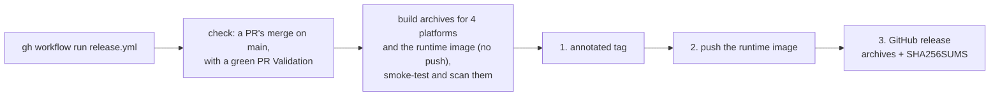

# CI and releases

## CI

| Workflow | Runs | Does |
|---|---|---|
| [`pr-validation.yml`](../../.github/workflows/pr-validation.yml) | every PR | lint (golangci-lint, `make vulncheck`: `govulncheck` on the source and on the `mro2nf`, `mre` and `mrjob` binaries, a `go mod tidy` check, `make deadcode`), build (`make cross`: every package and test compiled for each release platform), unit tests (`-race`), coverage, the e2e suites, `make lint-nf` and `make bench` |
| [`nightly.yml`](../../.github/workflows/nightly.yml) | daily, and weekly for the heavy tier | the e2e suites on the declared Nextflow floor and the latest stable release, with a 1,000-fork `make test-scale` smoke, the unit tests (`-race`) on Linux and macOS, `make lint-check`, `make vulncheck` and a Grype scan of the runtime image; weekly, the full scale tier and a long `make gen-diff` run |
| [`cdk-validation.yml`](../../.github/workflows/cdk-validation.yml) | changes to the CDK app | compiles and synthesizes the example AWS stack |
| [`release.yml`](../../.github/workflows/release.yml) | dispatched by hand | cuts a release ([below](#releases)) |

PR Validation does not run again on `main`: a PR merges only when it is up to
date with `main`, so its run already validated the merged tree. A PR that
changes only Markdown, `docs/`, `.claude/` or `LICENSE` skips the code jobs;
its Unit tests job runs only the tests that read those files: `test/docs`,
`test/divergence` and the untagged tests of `test/e2e`.

The nightly run skips a scheduled tier when the current `main` commit and the
latest stable Nextflow have already passed it, except the vulnerability scans,
`make vulncheck` and a Grype scan of the runtime image `main` builds, which
run every day because advisories and Debian's fixes arrive without a commit.
The weekly tier, or a dispatch
with `heavy`, keeps the shrunk repros of `make gen-diff` as an artifact. A
failed run opens, or comments on, a "Nightly CI is failing" issue.
Generative-differential divergences do not fail the run: they go to a
"Generative differential: new divergences" issue.

## Releases



A release is cut by dispatching `release.yml`, which creates the tag itself;
pushing a tag by hand releases nothing. Write the curated notes, such as
breaking changes and highlights, in Markdown to `notes.md`, then run:

```bash
gh workflow run release.yml -f version=v0.6.0 -f ref=main -F notes=@notes.md
```

`-F notes=@notes.md` passes the file's contents, so multi-line Markdown and its
headings arrive as written.

| Input | Default | Meaning |
|---|---|---|
| `version` | required | `v<major>.<minor>.<patch>`, optionally with a `-<prerelease>` suffix of dot-separated identifiers (`v0.6.0-rc1`, `v0.6.0-rc.1`) that git takes in a tag name. Its tag must not exist yet. |
| `ref` | `main` | the branch, tag or commit SHA to release, resolved to a commit |
| `notes` | none | the curated Markdown |
| `dry_run` | `false` | build everything, publish and tag nothing |

The Actions tab's "Run workflow" form offers the same inputs, but its notes
field holds a single line: leave it empty and edit the release's text once it
is published.

### What the workflow does

1. **Checks.** It requires the commit to be a PR's merge whose tree matches
   that PR's head, and that head to have a green PR Validation run. It refuses
   to run from any branch but `main`, since a dispatch runs the `release.yml`
   of the branch it names (`--ref`, by default `main`).
2. **Builds.** It cross-compiles `mro2nf`, `mre` and `mrjob` for Linux and
   macOS (amd64, arm64), packs one archive per platform, and builds the
   runtime image for linux/amd64 and linux/arm64 without pushing it, with
   SBOM and provenance attestations in its index. A Grype scan of each
   platform of the image fails the release on a High or Critical finding
   that has a fix.
3. **Smoke-tests.** Each archive runs on a runner of its platform:
   `mro2nf -version` and `mre version` must print the version, and `mrjob`
   must be executable. Each platform of the image must print the version
   from `mre version`, hold an executable `mrjob`, and run `aws --version`
   and `ps --version`.
4. **Publishes**, only once every build and smoke test succeeds, in this order:
   1. the annotated tag `<version>` on the commit, tagged by
      `github-actions[bot]`, whose message is the notes as written;
   2. the runtime image `ghcr.io/eunmann/mro2nf-runtime:<version>`, also
      tagged `latest` unless the version is a pre-release, the exact image
      built;
   3. the GitHub release on that tag, titled with it, with one archive per
      platform, `mro2nf-<version>-<os>-<arch>.tar.gz`, and a `SHA256SUMS` file
      covering the archives. Its body is the notes above the list of PRs merged
      since the previous tag that GitHub generates, grouped by
      `.github/release.yml`; without notes it is just that list.

A failed build, scan or smoke test therefore leaves no tag, image or release. If publishing itself
fails partway, delete whatever it created, the tag included, and dispatch
again. A pre-release is never the latest release.

### The archives

Each archive holds a single directory of the same name with `mro2nf`, `mre` and
`mrjob` under those names, as `mre` runs the `mrjob` beside it, plus `LICENSE`
and `THIRD_PARTY_NOTICES`.

The archives are reproducible: entries sorted by name, owned and writable only
by root, with the released commit's time, and gzip without a name or timestamp
(`test/e2e/workflow_release_test.go` runs the packaging step). Check a download
with `sha256sum -c SHA256SUMS --ignore-missing`. Releases after v0.6.0 also
carry build provenance for the archives and the image: check it with `gh
attestation verify <file> --repo eunmann/mro2nf`, or `gh attestation verify
oci://ghcr.io/eunmann/mro2nf-runtime:<version> --repo eunmann/mro2nf` for the
image. v0.6.0 and the releases before it have none (v0.6.0 was cut while the
repository was private, where GitHub offers no attestations), so `gh
attestation verify` finds nothing for them; `SHA256SUMS` is their only check.

### Dry runs

To check the pipeline without releasing, for example after an action bump on a
branch, add `-f dry_run=true`; `--ref` runs that branch's `release.yml`:

```bash
gh workflow run release.yml --ref <branch> -f version=v0.0.0-dryrun -f ref=<branch> -f dry_run=true
```

A dry run validates the inputs, the version's tag included, so it needs a
version never released, and builds the archives and the runtime image, but
skips the PR Validation and `main` requirements and tags and publishes nothing.
