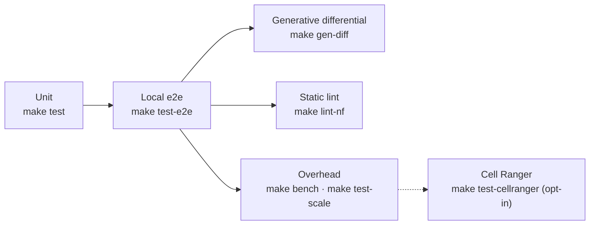

# Testing

mro2nf's correctness bar is `mrp` itself: every transpiled pipeline is compared
with the output of a real `mrp` run, and every difference must match an entry
of the divergence allowlist,
[`test/e2e/divergences.json`](../../test/e2e/divergences.json)
([Divergences](../reference/divergences.md)).

## Make targets

`make help` lists every target.

```bash
make build         # ./mro2nf, ./mre and ./mrjob (the pinned Martian's)
make test          # unit tests
make cover         # unit-test coverage gate (fails below COVER_MIN%)
make lint          # golangci-lint, with auto-fix
make lint-check    # golangci-lint, no auto-fix
make test-e2e      # golden table, mrp differential, failure parity, cloud-sim, knobs
make test-e2e-docker   # pipelines under the docker profile, in images built FROM the runtime image
make test-mrp-diff # the mrp differential alone
make lint-nf       # nextflow lint of every fixture's project
make bench         # orchestration overhead at two widths per shape
make test-scale    # the nightly scale tier
make gen-diff      # generated programs vs real mrp (GEN_SEEDS=<start>|random GEN_COUNT=<n>)
make docs-divergences  # regenerate docs/reference/divergences.md's table
```

## The test tiers



| Tier | Command | What it checks |
|---|---|---|
| Unit | `make test` | the call graph, resolver, topology, plan and posted records, the type walk and bundles, the generated project, and a stand-in run of every fixture's call graph through the `mre` subcommands |
| Local e2e | `make test-e2e` | the golden fixture table, transpiled, run under Nextflow and diffed against the committed `mrp` goldens; the live `mrp` differential (`TestMrpDiff`: the published tree, `_outs`, and every stage's `_args`, `_outs` and `_jobinfo`); failure parity (`TestMrpDiffFailureParity`: the fixtures `mrp` fails fail the same way); the call-graph replay of real `mrp` pipestances (`TestMrpCallGraph`); `-resume` stability |
| Generative differential | `TestGenDiff`, `make gen-diff` | random well-typed programs (`test/gen`) run under live `mrp` and under mro2nf, facing the same output, stage-ABI and failure-parity checks as the fixtures |
| Static lint | `make lint-nf` | every fixture's project under `nextflow lint`, errors and warnings alike, plus a generated pipeline large enough for `subworkflows/` |
| Overhead | `make bench`, `make test-scale` | tasks, staged bytes and driver heap at two widths per shape ([Benchmarks](benchmarks.md)) |
| Cell Ranger | `make test-cellranger` | the real Cell Ranger `count` pipeline under both runners ([below](#cell-ranger)) |

### The e2e suites

The e2e suites are Go tests in [`test/e2e`](../../test/e2e), behind the build
tag `e2e`, always run with `-count=1` so the test cache cannot return a stale
pass. `make test-e2e` runs each fixture's transpiled pipeline under Nextflow in
a bounded parallel pool (`E2E_PARALLEL=<n>`, default 10).

The `mrp` suites need a Martian build at `MARTIAN_BIN` (default
`~/workdir/martian/bin`) and skip without one. Every fixture faces live `mrp`
except the two `mrp` cannot complete, `exec_min` and `mixed_adapters`
(`mrpUnrunnable` in
[`test/e2e/coverage_test.go`](../../test/e2e/coverage_test.go)), which have
goldens only. [`testdata/README.md`](../../testdata/README.md) explains the
fixtures and how their goldens are recorded.

### The generative differential

Random well-typed programs from [`test/gen`](../../test/gen), whose stub
stages derive every output from a hash of their inputs, run under live `mrp`
and under mro2nf.

- Any difference in the published outputs, a stage's `_args`/`_outs` or the
  run outcome is shrunk to a minimal fixture with its `mrp` golden.
- Each program runs at its literal invocation and again at its witness
  invocation, which forks every entry collection at differing nested widths.
- A run in which `mrp` ran a job on bindings it failed to resolve (it passes
  `null` in their place, #606) is no test.
- Every comparator rule of the divergence allowlist, issue-tracked ones
  included, excuses a difference there, though none is reported as excusing
  nothing; the ABI and outcome matchers, which name their fixtures, do not
  apply.
- `make test-e2e` runs a fixed smoke set of seeds; `make gen-diff` runs a seed
  range for the long tier, which the weekly nightly starts from a random seed
  and ends after `GEN_BUDGET` minutes.

## Cell Ranger

An opt-in local check against a real production pipeline: 10x Genomics Cell
Ranger's `cellranger testrun`, the `count` pipeline on its bundled tiny
dataset, run by `mrp` and by the transpiled project, with
`metrics_summary.csv` compared byte for byte. Cell Ranger is licensed software
and is not in this repository, so the check runs only where a bundle is
extracted, never in CI.

```sh
CELLRANGER_HOME=~/Downloads/cellranger-10.1.0 make test-cellranger
```

`TestCellRangerDifferential`
([`test/e2e/cellranger_test.go`](../../test/e2e/cellranger_test.go)) skips
unless `CELLRANGER_HOME` points at an extracted bundle holding
`bin/cellranger`, `sourceme.bash`, `mro` and the bundled Martian runtime. With
the bundle's environment sourced, it:

1. writes the `count` invocation `.mro` with `cellranger testrun --dry`;
2. runs it under the bundle's `mrp` (`--jobmode=local --nopreflight`), sized by
   `CELLRANGER_LOCALCORES` and `CELLRANGER_LOCALMEM` (default 4 cores, 8 GB);
3. transpiles the same `.mro` with `-mropath <bundle>/mro`;
4. runs the project on the `standard` profile, with the stages under the
   bundle's own `mrjob` and adapters (`--mro2nf_mrjob`, `--mro2nf_adapters`),
   and with `process.resourceLimits` set to the same cores and memory. Each job
   is granted from that pool and its task clamped to it, so the 30 GB cloupe
   join runs on a smaller machine, as `mrp` grants it;
5. requires `metrics_summary.csv` to be byte-identical, and the main outputs
   (`filtered_feature_bc_matrix.h5`, `raw_feature_bc_matrix.h5`,
   `cloupe.cloupe`, `web_summary.html`, `possorted_genome_bam.bam`,
   `molecule_info.h5`) to be published;
6. logs the task counts from the trace.

With Cell Ranger 10.1.0 the test passes: `metrics_summary.csv` is
byte-identical to `mrp`'s, and the Nextflow run has 110 tasks, 108 stage tasks
plus PLAN and OUTS. It runs the pipeline twice; on the machine it was last run
on it took about 8 minutes. `make test-e2e` excludes it.

## Live AWS runs

[AWS validation](../reference/aws-validation.md) records the live runs on AWS
Batch and HealthOmics, and
[`deploy/awsbatch-cdk`](../../deploy/awsbatch-cdk/README.md) deploys the stack
they ran on.
