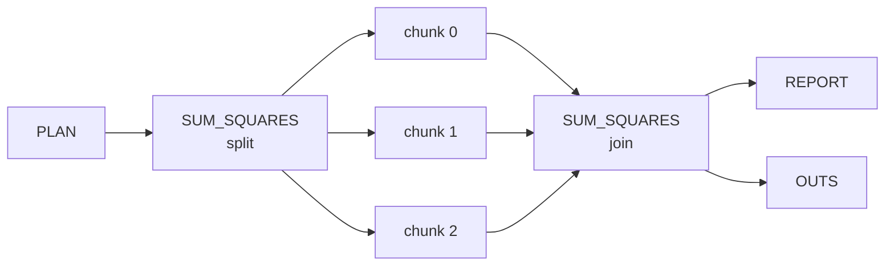

# Getting started

This page installs mro2nf, transpiles a small pipeline and runs it.

## Prerequisites

| Need | Why |
|---|---|
| Java 17 to 26 and Nextflow 26.04 or later | to run the generated project (`curl -s https://get.nextflow.io \| bash`) |
| Python 3 | to run `py` stages on the local and grid profiles |
| Docker | only for the container profiles |
| Go 1.27 and `make` | only to build mro2nf from source |

The generated `nextflow.config` sets `manifest.nextflowVersion '!>=26.04.0'`,
so an older Nextflow refuses to run it. The project also needs Nextflow's
default strict (v2) syntax parser: under `NXF_SYNTAX_PARSER=v1`, Nextflow
converts command-line values before the run sees them (`--s 007` becomes the
number `7`).

## Install

### From a release

Each [release](https://github.com/eunmann/mro2nf/releases) has one archive per
platform, `mro2nf-<tag>-<os>-<arch>.tar.gz` for `linux` and `darwin` on `amd64`
and `arm64`, and a `SHA256SUMS` file covering them. Verify the archive, extract
it and put its directory on `PATH`:

```bash
tag=v1.2.3 platform=linux-amd64       # the release and your <os>-<arch>
base=https://github.com/eunmann/mro2nf/releases/download/$tag
curl -fL -O "$base/mro2nf-$tag-$platform.tar.gz" -O "$base/SHA256SUMS"
grep " mro2nf-$tag-$platform.tar.gz\$" SHA256SUMS | sha256sum -c   # macOS: shasum -a 256 -c
tar -xzf "mro2nf-$tag-$platform.tar.gz"
export PATH="$PWD/mro2nf-$tag-$platform:$PATH"
mro2nf -version
```

The archive holds three programs, plus `LICENSE` and `THIRD_PARTY_NOTICES`:

| Program | Role |
|---|---|
| `mro2nf` | the transpiler you run once per pipeline |
| `mre` | the runtime shim every task of a run calls |
| `mrjob` | Martian's job runner, which `mre` uses to run `py` and `comp` stages |

Keep `mre` and `mrjob` in the same directory: `mre` runs the `mrjob` beside it.

Each release also publishes a runtime image,
`ghcr.io/eunmann/mro2nf-runtime:<tag>`, for the container profiles
([Container images](user-guide/container-images.md)).

### From source

```bash
git clone https://github.com/eunmann/mro2nf
cd mro2nf
make install                          # mro2nf, mre and mrjob into ~/.local/bin
export PATH="$HOME/.local/bin:$PATH"
mro2nf -version
```

`make install PREFIX=<dir>` installs into `<dir>/bin` instead.

## A first run

From a clone of this repository, transpile the `testdata/split_test` fixture
and run it with the array input `values = [5, 6, 7]`:

```bash
mro2nf -o out testdata/split_test/pipeline.mro
cd out
echo '{"values": [5, 6, 7]}' > inputs.json
nextflow run main.nf -params-file inputs.json
cat results/pipeline_outs.json
```

The output is:

```json
{
    "sum": 110
}
```

The run has 8 tasks:



- **PLAN** compiles the run's invocation, with your input values, as `mrp`
  would.
- **`SUM_SQUARES`** is a split stage: one task splits the work, one task runs
  per chunk, and one task joins the results. `mrp` runs the same three kinds
  of job.
- **`REPORT`** is an ordinary stage.
- **OUTS** lays out the published outputs.

Each input of the pipeline is a run parameter. Without one, the run uses the
value in the `.mro`'s `call`. Pass a scalar on the command line (`--n 5`), and
an array, map or struct as typed JSON in a `-params-file`. Give file inputs as
absolute paths. [Parameters](user-guide/parameters.md) has the details.

> [!IMPORTANT]
> The generated project refers to the entry `.mro`, its includes and its
> stage code by the absolute paths they had at transpile time. Don't move or
> delete them; if you do, transpile again.

## Outputs

| Path | Holds |
|---|---|
| `results/` | the published outputs: `mrp`'s `outs/` tree and `pipeline_outs.json` |
| `work/` | one directory per task, with the stage's metadata and logs |
| `.nextflow/`, `.nextflow.log`, `trace-<timestamp>.txt` | Nextflow's run state, log and task trace |

A failed run publishes nothing to `results/`. To publish somewhere else,
including an `s3://` prefix, pass Nextflow's `-output-dir <dir>`, or set
`outputDir = '<dir>'` in a `-c` config.

## Resume

```bash
nextflow run main.nf -params-file inputs.json -resume
```

A rerun with nothing changed takes all 8 tasks from the cache. A changed
input re-runs every task.

> [!WARNING]
> Nextflow does not see edits to stage code. After you change stage code, run
> without `-resume`.

Two Nextflow version notes:

- The first `-resume` under Nextflow 26.04 of a run an older Nextflow started
  re-runs every task: 26.04 hashes a map input by its keys and values, where
  older releases hashed only its values, and every task takes one.
- Nextflow 26.04.0 and 26.04.1 leave the `params.*` a task's script reads out
  of its `-resume` hash (nextflow-io/nextflow#7156, fixed in 26.04.2). On
  them, a `-resume` that changes an `--mro2nf_*` parameter PLAN reads reuses
  the cached PLAN; run without `-resume` after changing one.

## Next steps

- Run in containers or on AWS: [Profiles](user-guide/profiles.md) and
  [Container images](user-guide/container-images.md).
- Size the tasks: [Resources and retries](user-guide/resources-and-retries.md).
- Check your pipeline's features: [Feature coverage](reference/feature-coverage.md).
