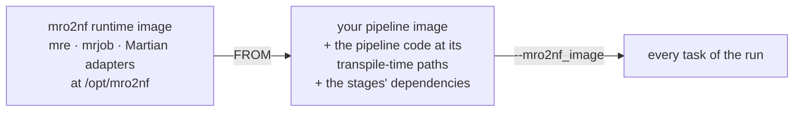

# Container images

The `docker`, `awsbatch` and `healthomics` profiles run every task in one
image, which you name with `--mro2nf_image`. You build that image `FROM` the
mro2nf runtime image and add your pipeline's code.



## The runtime image

The runtime image is `ghcr.io/eunmann/mro2nf-runtime:<tag>`. It has `mre`,
`mrjob` and the Martian adapters at `/opt/mro2nf` on its `PATH`, on a
`python:3.12-slim` base. Use the tag of the mro2nf release that transpiled the
project (what `mro2nf -version` prints for a release build): PLAN fails a run
whose `mre` is another build than the `mro2nf` that transpiled the project,
with `project transpiled by <build>, mre is <build>`.

For a build of an unreleased commit, build the runtime image from the same
checkout, with `--build-arg VERSION` set to the build your `mro2nf` names, so
the image's `mre` names the same one:

```bash
docker build --build-arg VERSION="$(mro2nf -version | cut -d' ' -f2)" \
  -f deploy/runtime/Dockerfile -t mro2nf-runtime:local .
```

Without it, the image's `mre` is the build `dev`, which matches only an
`mro2nf` that is `dev` too, such as one built in a git worktree.

## Your pipeline's image

A task looks for the pipeline's code, the entry `.mro` included, at the
absolute path it was transpiled from, so copy the code to that same path in
the image. For the [first run](../getting-started.md#a-first-run), from the
root of the clone:

```bash
cat > split_test.Dockerfile <<EOF
FROM mro2nf-runtime:local
COPY . $PWD/testdata/split_test/
EOF
docker build -f split_test.Dockerfile -t split-test:local testdata/split_test
cd out
nextflow run main.nf -profile docker --mro2nf_image split-test:local -params-file inputs.json
```

The build context, `testdata/split_test`, is the directory the code is in, and
`COPY` writes it to the path `mro2nf` read it from.

Install anything else your stages need in the same Dockerfile, such as Python
packages, or the program that a stage whose `src` names a command runs, on
the image's `PATH`.

> [!NOTE]
> Each task checks that the code in the image compiles to the same pipeline
> PLAN planned. An image built from other sources than the ones transpiled
> fails the task with `the node compiles to another spec than the run's plan
> holds` ([Troubleshooting](troubleshooting.md#error-messages)).

## A pipeline shipped as a bundle

A vendor bundle such as Cell Ranger runs its stages under its own environment
and writes the call it runs into a generated `.mro`. These steps ran Cell
Ranger 10.1.0 `count` on AWS Batch and HealthOmics:

1. Write the invocation without running it: `cellranger count --id=<id>
   --fastqs=<dir> --transcriptome=<dir> --dry` writes `__<id>.mro` into the
   working directory. The paths it names only need to exist for the dry run;
   the real inputs are run parameters.
2. Transpile it against the bundle's `.mro` tree:
   `mro2nf -mropath <bundle>/mro -o out __<id>.mro`.
3. Build the image `FROM` the runtime image. `COPY` the bundle and
   `__<id>.mro` to the absolute paths they had at transpile time, and set the
   environment the bundle's `sourceme.bash` sets as `ENV` lines (its `PATH`
   entries, ahead of `/opt/mro2nf`, `PYTHONPATH`, `MROPATH`, and the rest).
   `env -i bash -c 'source <bundle>/sourceme.bash; env'` prints them.
4. Pass the inputs as a `-params-file` with the same typed values as the
   `.mro`'s call, with the paths replaced by `s3://` URIs. A struct array such
   as Cell Ranger's `sample_def` goes in whole.

```dockerfile
FROM <runtime image>
COPY . /opt/cellranger-10.1.0/
COPY __pbmc.mro /work/pbmc/
ENV PATH=/opt/cellranger-10.1.0/lib/bin:/opt/cellranger-10.1.0/external/martian/bin:/opt/cellranger-10.1.0/external/anaconda/bin:/opt/cellranger-10.1.0/bin/tenkit:/opt/cellranger-10.1.0/bin:/opt/mro2nf:/usr/local/sbin:/usr/local/bin:/usr/sbin:/usr/bin:/sbin:/bin \
    MROPATH=/opt/cellranger-10.1.0/mro \
    PYTHONPATH=/opt/cellranger-10.1.0/lib/python:/opt/cellranger-10.1.0/external/martian/adapters/python
```

Cell Ranger's stages write the FASTQ path they were given into JSON that later
stages open, so on `awsbatch` the FASTQ bucket must be mounted
([Paths written into text](files-and-paths.md#paths-written-into-text)).

## A CUDA image

A container profile runs every task in one image, so a pipeline with a GPU
stage needs one CUDA image for all its stages. Copy mro2nf's runtime into it,
since the runtime image's base is `python:3.12-slim`:

```dockerfile
FROM ghcr.io/eunmann/mro2nf-runtime:<version> AS mro2nf
FROM nvidia/cuda:12.4.1-runtime-ubuntu22.04
# ps for Nextflow's task metrics, python3 for py stages, the aws CLI for Batch
RUN apt-get update \
 && apt-get install -y --no-install-recommends procps python3 awscli \
 && rm -rf /var/lib/apt/lists/*
COPY --from=mro2nf /opt/mro2nf /opt/mro2nf
ENV PATH="/opt/mro2nf:${PATH}"
COPY . /abs/path/the/pipeline/was/transpiled/from/
```

The host supplies the NVIDIA driver. The image needs the CUDA user-space
libraries and your GPU toolkit, at a CUDA version the driver supports.
