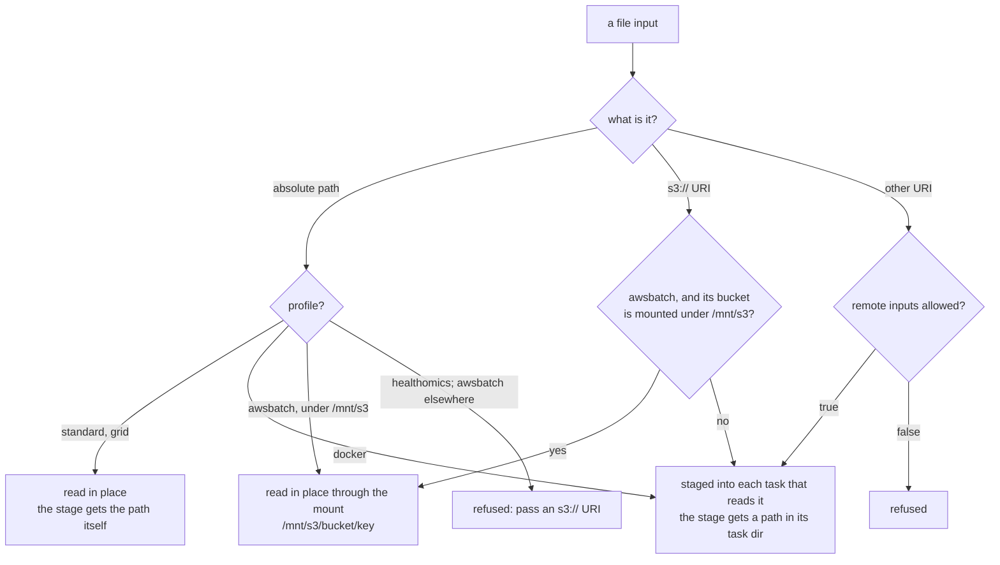

# Files and paths

`mrp` runs every job on one shared filesystem, so any job can open any path.
A Nextflow task may run in its own container or on its own machine, and sees
only the files staged into it. This page explains how mro2nf gets each file to
the stage that reads it, and where that differs from `mrp`.

## File inputs

A file input is an absolute path or an `s3://` URI. Other schemes (`http://`,
`https://`, `ftp://`) are refused unless you pass
`--mro2nf_allow_remote_inputs true`.

How a task reaches a file input depends on the profile:

### Read in place

On the `standard` and grid profiles, whose tasks run on the host's
filesystem, every task reads an absolute path where it is, and the stage
receives that path, as under `mrp`. Nothing is copied or linked into a task's
directory. A stage that writes the path into text for another stage to open
finds it in every task.

A path that is or holds the run's work directory is refused: every task would
read its own directories as an input.

### Staged

On the `docker` profile an absolute path is staged, as is a URI input on every
profile. Each task that reads it stages its own copy, and the stage receives a
path in its own task directory, with the same file name and content, where
`mrp` would pass the original path (the divergence
[`staged-input-paths`](../reference/divergences.md)).

### Read through the S3 mount

On `awsbatch`, an `s3://` input of a bucket the instances mount is read in
place: see [Profiles](profiles.md#reading-s3-inputs-in-place).

### `-resume` and changed data

`-resume` keys an input read in place on its path, as `mrp`'s restart keys a
pipestance on its invocation: a run over a file changed at the same path
reuses the cached tasks. A staged input is keyed on its path, size and
modification time, as Nextflow keys a file; for a directory that is the
directory's own size and time, which a change to a file inside it leaves as
they were.

> [!TIP]
> Give changed data a new path, or run without `-resume`.

## Companion files

A task stages only the files an input names, not the files beside them. A
stage that opens a companion file next to its input, such as an index beside a
BAM, finds it under `mrp`, but not under mro2nf when the input is another
stage's output or a staged input (the divergence
[`input-file-siblings`](../reference/divergences.md)).

To fix it, do one of these:

- declare the companion as its own input, and as its own output of the stage
  that writes it, and have the stage open it from that input;
- pass a directory input that holds both files.

HealthOmics
[requires the same](https://docs.aws.amazon.com/omics/latest/dev/workflows-run-inputs.html)
of index files. An input read in place, on `standard` and the grid profiles
or through the `awsbatch` mount, has its directory beside it, as under `mrp`.

## Paths written into text

mro2nf supports Martian's typed file flow: a `path` or `file` value, and each
file leaf of a struct, array or map whose type declares it, reaches every task
that reads it, on every profile.

A stage that writes a path into text, such as the contents of a JSON or CSV
file, an untyped `map` or a `string`, for a later job to open relies on
`mrp`'s shared filesystem. No task stages such a path, so it opens only where
the later task sees the same file at that path. This is out of scope, not a
bug: give the file a file type and it reaches every task that reads it.

| Profile | path of a file input | path of a stage's output | path in an untyped input |
|---|---|---|---|
| `standard`, grid | opens | opens | opens where the tasks see it |
| `docker` | a head-node input fails: it is a link to a host path that only the tasks staging it mount; an `s3://` or other remote input opens, as Nextflow downloads it under the work directory | opens: a task that stages a file from the work directory mounts all of it | fails: no container mounts it |
| `awsbatch` | opens for an `s3://` input read through the S3 mount; a staged input fails | fails: each task runs in its own scratch directory | fails, unless it is under the S3 mount |
| `healthomics` | opens: HealthOmics stages the run's inputs once, read-only, for every task | opens: the work directory is on the run's shared storage | fails: no task stages it |

Known pipelines affected:

- Cell Ranger `multi` and `aggr` take a CSV that lists input paths. They run
  where every task sees those paths: `standard`, grid, and `awsbatch` when the
  paths are under the S3 mount.
- Cell Ranger `count` writes its FASTQ path into JSON that later stages open.
  It runs on `standard`, grid and `healthomics`, on `docker` only with its
  FASTQs given as an `s3://` URI, and on `awsbatch` only with its FASTQ
  bucket mounted.

## File names Nextflow cannot stage

Nextflow's stage-in script leaves `*`, `?`, `[`, `]`, `{`, `}`, `$` and
control characters unquoted, so bash would expand them: `s[1].txt` beside
`s1.txt` would silently stage `s1.txt`. PLAN therefore refuses a staged input
whose path holds any of them, naming the input and the character, before
anything is staged.

Rename such a file. On the `standard` and grid profiles, which read
head-node paths in place, you can also pass it as an absolute path rather
than a `file:` URI: a path read in place is never staged, so it may hold any
character, as under `mrp`.
